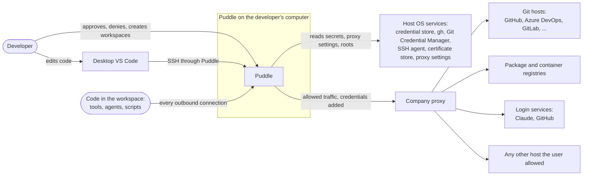
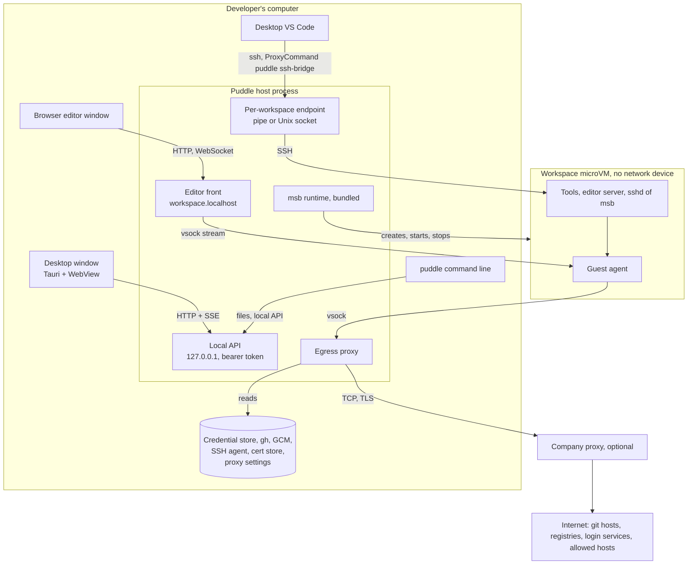

# 3. Context and scope

Puddle against its surroundings: who uses it, which systems it talks to and over which channels.
Puddle is the box in the middle. What is inside it is section 5.

## 3.1 Business context

| Partner                                     | What it gives Puddle or takes from it                                                                                                                                                                                                                    |
| ------------------------------------------- | -------------------------------------------------------------------------------------------------------------------------------------------------------------------------------------------------------------------------------------------------------- |
| **Developer**                               | Creates, starts, stops and deletes workspaces; answers the Inbox (allow or deny a destination, once or as a rule); manages rules, identities and settings; reads the activity log. Uses the desktop app, the `puddle` command line and a browser editor. |
| **Code in the workspace**                   | Untrusted. Anything that runs in the VM: build tools, package managers, tests, coding agents. It opens connections and runs git; it gets answers or refusals with a reason, and stand-ins instead of real credentials.                                   |
| **Desktop VS Code** (and other SSH clients) | Attaches to a workspace over SSH through Puddle. Attaching a desktop editor trusts the workspace with the editor's own channel back to the computer, and Puddle says so.                                                                                 |
| **Host OS services**                        | The credential store keeps tokens and the API's secrets; `gh`, Git Credential Manager and the SSH agent supply git credentials; the certificate store supplies company roots; the system proxy settings say how to reach the internet.                   |
| **Company proxy**                           | Optional. When the network has one, every outbound connection from Puddle, its own included, goes through it, with the sign-in it asks for.                                                                                                              |
| **Git hosts**                               | Clone, fetch and push over HTTPS or SSH, with the identity's token added by Puddle; repository listing for the create form.                                                                                                                              |
| **Registries**                              | Package registries (npm, crates.io, PyPI, and so on) are ordinary allowed destinations; container registries also serve the workspace's image when it boots.                                                                                             |
| **Login services**                          | Tools that hold their own login (Claude Code, the GitHub CLI) sign in through Puddle, which keeps the real token and hands the tool a stand-in.                                                                                                          |
| **Any other host**                          | Reachable only after the user allowed it.                                                                                                                                                                                                                |

## 3.2 Technical context

| Channel                 | From → to                           | Protocol                                                                                                                              | Code                                                                                                                    |
| ----------------------- | ----------------------------------- | ------------------------------------------------------------------------------------------------------------------------------------- | ----------------------------------------------------------------------------------------------------------------------- |
| Desktop window          | User → Puddle                       | Tauri 2 window loading the single-page app from the local API's origin; the host runs in the same process                             | `crates/puddle-app`                                                                                                     |
| Local API               | UI, command line → host             | HTTP and server-sent events on `127.0.0.1`; Host, Origin and bearer-token checks; token in an owner-only file                         | `crates/puddle-api/src/server.rs`, `crates/puddle-api/src/auth.rs`, `crates/puddle-api/src/token.rs`                    |
| Command line            | User → host                         | `puddle doctor`, `backup`, `audit`, `secrets`, `user`, `ssh-bridge`                                                                   | `crates/puddle/src/cli.rs`                                                                                              |
| Browser editor          | Browser → guest editor server       | HTTP and WebSocket to `<workspace>.localhost:<port>`, one origin per workspace; forwarded ports at `<port>.<workspace>.localhost`     | `crates/puddle-front/src/lib.rs`                                                                                        |
| Desktop editor over SSH | VS Code → guest                     | SSH with `puddle ssh-bridge` as `ProxyCommand`, to a pipe or socket only the user can open, then msb's SSH server                     | `crates/puddle/src/cmd/ssh_bridge.rs`, `crates/puddle-ipc`, `crates/puddle-ssh`, `crates/puddle-host/src/ssh_config.rs` |
| Guest traffic           | Guest → host                        | vsock, multiplexed streams (outbound connections, name lookups, editor, port forwards) carried by the guest agent                     | `crates/puddle-agent`, `crates/puddle-agent-proto`, `crates/puddle-ports`                                               |
| VM control              | Host → VM                           | msb SDK and the bundled runtime: create, start, stop, volumes, exec, image pull                                                       | `crates/puddle-compute-msb`, `crates/puddle-runtime`                                                                    |
| Boot                    | Host → guest                        | Boot hook that writes proxy settings, trust roots and the session user before SSH or exec is allowed                                  | `crates/puddle-boot`, `crates/puddle-guest-env`, `crates/puddle-certs`                                                  |
| Outbound traffic        | Proxy → internet                    | HTTP CONNECT and plain HTTP from the guest; TLS terminated only for hosts that get a credential; the rest spliced                     | `crates/puddle-proxy`, `crates/puddle-inject`, `crates/puddle-ca`                                                       |
| Git over SSH            | Guest → git host                    | SSH ended at the proxy and turned into smart-HTTP requests with the identity's token                                                  | `crates/puddle-proxy/src/ssh_git`                                                                                       |
| Image pulls             | Runtime → container registry        | Registry requests through a loopback pull proxy that takes the same route out                                                         | `crates/puddle-proxy/src/pull.rs`, `crates/puddle-compute-msb/src/image.rs`                                             |
| Repository listing      | Host → GitHub, Azure DevOps         | REST API calls (`api.github.com`, `dev.azure.com`) from the host over Puddle's own route                                              | `crates/puddle-repos`                                                                                                   |
| Login capture           | Guest tool → login service          | The proxy rewrites the token endpoint's answer: the real token goes to the OS store, the tool gets a stand-in                         | `crates/puddle-logins`                                                                                                  |
| Company proxy           | Proxy → upstream proxy              | Discovery from WinINet, WinHTTP PAC/WPAD, policy and environment; sign-in with Negotiate, NTLM or Basic; chained CONNECT              | `crates/puddle-upstream`                                                                                                |
| Secrets                 | Host → OS                           | OS credential store; `gh auth token`, `git credential fill`; the SSH agent's pipe or socket                                           | `crates/puddle-secrets`, `crates/puddle-ssh-agent`                                                                      |
| Company roots           | Host → OS certificate store → guest | The host's admin- and user-added roots, minus the disallowed ones, written into the guest's CA bundle                                 | `crates/puddle-certs`                                                                                                   |
| Editor server download  | Guest → Microsoft                   | Microsoft's VS Code server is fetched only after the user accepted Microsoft's terms; the open-source editor server ships with Puddle | `crates/puddle-agent/src/microsoft.rs`, `crates/puddle-settings/src/consent.rs`, `ci/fetch-code-server.sh`              |

Two facts the diagram makes visible:

- **The VM has no network device.** Every arrow out of the VM goes through the guest agent and vsock
  into the host process (`crates/puddle-compute-msb/src/spec.rs`). There is no route around the proxy.
- **Puddle's own outbound calls take the same route out.** Repository listing, image pulls and the
  proxy's upstream connections all use the company-proxy route of `crates/puddle-upstream`, so a
  network that needs a proxy needs it configured once.

## 3.3 Scope

In scope for the first release: one user on their own Windows or Linux computer, with the desktop
app, the command line, any number of workspaces, and the partners above.

Out of scope, and why:

- **macOS hosts.** Kept possible (the runtime's file table has a macOS row,
  `crates/puddle-runtime/src/platform.rs`) but not supported: `puddle doctor` says so.
- **Remote and multi-user serving.** `puddle serve`, with browser sign-in and several users, is built
  but dormant behind the `serve` cargo feature, and a release build may not turn it on
  (`ci/check-dormant-release.sh`). The desktop app never has accounts.
- **An update check.** The signed freshness file of a future update list exists
  (`crates/puddle-freshness`), but no product code reads it yet: the first release makes no outbound
  call the user did not ask for.
- **Telemetry and crash reports of Puddle's own.** None exist; if added, they are opt-in
  ([principles](../principles.md), 8). The WebView's own crash upload is switched off
  (`crates/puddle-app/src/webview_environment.rs`).
- **Defending against malware running as the same user on the host, or an escape from the VM through
  the runtime itself.** The design relies on the VM boundary and on the host account; it does not
  protect the host from itself.
