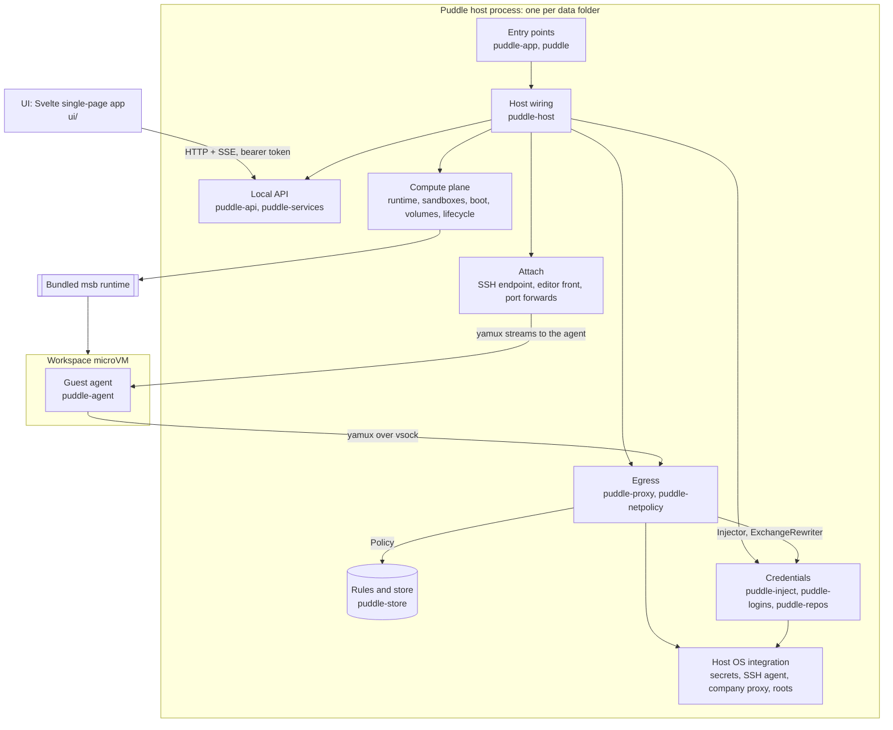
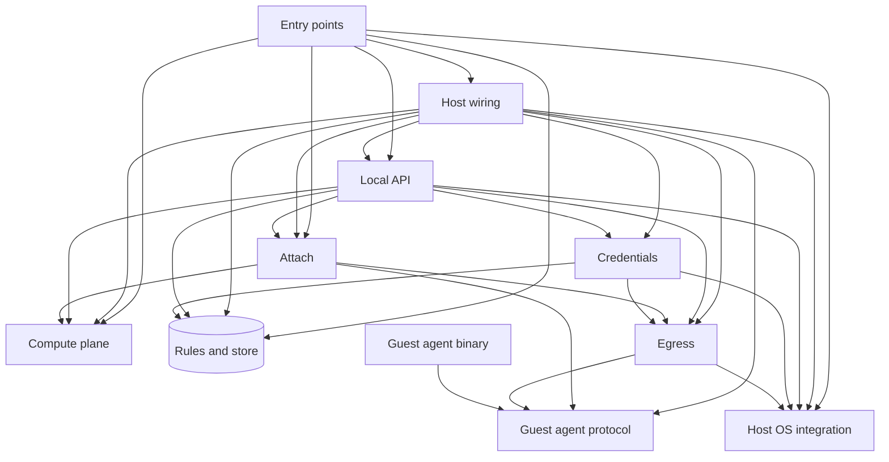

# 5. Building block view

The static decomposition of Puddle into building blocks. Level 1 is the whole system as a white
box; level 2 opens each crate under `crates/`, the UI under `ui/`, the guest agent and the build
tooling, with its responsibility, its interfaces and what it depends on.

The Rust code is one cargo workspace (`members = ["crates/*"]` in the root `Cargo.toml`) of 46
crates: 39 that ship or build what ships, 6 that only tests use, and `xtask`. Every crate's
`src/lib.rs` (or `src/main.rs`) starts with a module comment that says what it is for; this page is
the map, and those comments are the detail.

## 5.1 Level 1: the whole system

| Block                   | Responsibility                                                                                                               | Section 5.2 |
| ----------------------- | ---------------------------------------------------------------------------------------------------------------------------- | ----------- |
| **Entry points**        | The two programs a user starts: the desktop app and the `puddle` command line. Both start the same host.                     | 5.2.1       |
| **Host wiring**         | Starts and stops every other block in one fixed order and connects their interfaces.                                         | 5.2.2       |
| **Local API**           | HTTP and server-sent events on loopback for the UI and the command line; the service traits the host implements.             | 5.2.3       |
| **Egress**              | The only way out of a workspace: target parsing, destination guard, rule decision, route out, TLS termination, audit.        | 5.2.4       |
| **Rules and store**     | SQLite: rules, pending requests, audit log, identities; answers the proxy's questions.                                       | 5.2.5       |
| **Credentials**         | Adds the right credential to a decrypted request; keeps captured logins on the host; lists the repositories a token reaches. | 5.2.6       |
| **Host OS integration** | Reads what the host OS holds: secrets, the SSH agent, the company proxy and its sign-in, the company's root certificates.    | 5.2.7       |
| **Compute plane**       | The bundled runtime, sandboxes and volumes behind traits, the boot hook, shutdown and reconcile.                             | 5.2.8       |
| **Attach**              | The ways in from the host: SSH for desktop editors, the browser editor's front, forwarded ports.                             | 5.2.9       |
| **Guest agent**         | The one Puddle program inside the VM: carries every connection to the host and serves the host's streams.                    | 5.2.10      |
| **UI**                  | The Svelte single-page app the desktop window shows, served by the local API.                                                | 5.3         |

The arrows marked with a trait name are dependency inversions: the proxy calls a trait that
`puddle-types` or `puddle-proxy` defines, and the host plugs in the store or the credential crates.
So `puddle-proxy` does not depend on `puddle-store`, `puddle-inject` or `puddle-logins`, and its
tests run with fakes.

## 5.2 Level 2: the crates

Each table lists a crate's responsibility, the interfaces other crates use, and the Puddle crates
it depends on under `[dependencies]` (dev-dependencies left out). The last column is taken from the
crate's `Cargo.toml`; `cargo tree -p <crate> -e normal --depth 1` shows the same list.

### 5.2.1 Entry points

| Crate        | Responsibility                                                                                                                                                                                                                                                                                  | Interfaces                                                                                           | Depends on                                                                                 |
| ------------ | ----------------------------------------------------------------------------------------------------------------------------------------------------------------------------------------------------------------------------------------------------------------------------------------------- | ---------------------------------------------------------------------------------------------------- | ------------------------------------------------------------------------------------------ |
| `puddle-app` | The desktop app: a Tauri 2 window around the single-page app, the tray, notifications, the quit sequence, the browser editor's windows. Runs the host in the same process; the page loads from the API's own loopback origin, and the main window has one Tauri permission (the folder picker). | Binary `puddle-app`; `crates/puddle-app/capabilities/main.json` is the window's whole permission set | api, appicon, compute, fs, host, lifecycle, log, no-dump, services, settings, store, types |
| `puddle`     | The command line: `doctor`, `backup`, `audit`, `secrets`, `user`, and `ssh-bridge`, the relay desktop SSH clients run as their `ProxyCommand`. `serve` exists only with the dormant `serve` feature.                                                                                            | Subcommands in `crates/puddle/src/cli.rs`, one module each under `crates/puddle/src/cmd/`            | api, doctor, fs, host, lifecycle, log, no-dump, secrets, settings, ssh, types              |

### 5.2.2 Host wiring

| Crate         | Responsibility                                                                                                                                                                                                                                                                                                                                                                                                                                                        | Interfaces                                                                                                                                                                      | Depends on                        |
| ------------- | --------------------------------------------------------------------------------------------------------------------------------------------------------------------------------------------------------------------------------------------------------------------------------------------------------------------------------------------------------------------------------------------------------------------------------------------------------------------- | ------------------------------------------------------------------------------------------------------------------------------------------------------------------------------- | --------------------------------- |
| `puddle-host` | The host process as a library and the one place that knows every other crate. A synchronous `prepare` locks the data folder, binds the pull proxy, pins the runtime environment, checks the bundled runtime and reads the company roots; `Host::start` then starts the store, the company-proxy chain, the runtime, reconcile, the proxies, the workspaces and the API, and `shutdown` undoes them in reverse. It implements the service traits of `puddle-services`. | `prepare`, `Host::start`, `Host::shutdown`; the ordered step lists `START_STEPS` and `SHUTDOWN_STEPS` (`crates/puddle-host/src/lib.rs`, `crates/puddle-host/src/host/steps.rs`) | 31 of the 38 other product crates |

The seven product crates `puddle-host` does not use are the two entry points, the guest agent, the
`puddle-log` and `puddle-no-dump` start-up helpers (the entry points call those), `puddle-appicon`
(the API and the shell use it) and `puddle-freshness`.

### 5.2.3 Local API

| Crate             | Responsibility                                                                                                                                                                                                                                                | Interfaces                                                                                                 | Depends on                                                                                                    |
| ----------------- | ------------------------------------------------------------------------------------------------------------------------------------------------------------------------------------------------------------------------------------------------------------- | ---------------------------------------------------------------------------------------------------------- | ------------------------------------------------------------------------------------------------------------- |
| `puddle-api`      | The axum HTTP API on `127.0.0.1` with a server-sent event stream. Every request passes a Host check, an Origin check and a bearer token before any handler. Writes the OpenAPI contract; with the `embedded-ui` feature it serves `ui/build` from the binary. | `ApiServer`; the routes under `/api/*`; the contract `crates/puddle-api/openapi/openapi.json`              | appicon, certs, doctor, front, fs, ipc, netpolicy, repos, secrets, services, settings, store, types, upstream |
| `puddle-services` | The service traits the API serves and the host implements (`WorkspaceService`, `CredentialService`, `PortsService`, `DoctorService`, ...), the wire types, and in-memory fakes so the API and the UI fixture run without VMs.                                 | One trait per area, plus `ApiError` and `ApiErrorBody` (`crates/puddle-services/src/lib.rs`)               | certs, doctor, netpolicy, repos, secrets, settings, store, types, upstream                                    |
| `puddle-doctor`   | `puddle doctor` and the same checks inside the app: CPU virtualisation, hypervisor, code integrity, the bundled runtime, a test boot, disk space; each finding with its exact fix.                                                                            | The checks in `crates/puddle-doctor/src/diagnose.rs`, the wording in `crates/puddle-doctor/src/explain.rs` | fs, process, runtime, secrets, ssh-agent                                                                      |
| `puddle-appicon`  | The window, tray and taskbar icon: the built-in duck icons at any size, and the check and resize of an image the user gives.                                                                                                                                  | `built_in`, `normalize_upload`, `Icon`                                                                     | settings                                                                                                      |

### 5.2.4 Egress

| Crate              | Responsibility                                                                                                                                                                                                                                                                                                                                                                                                                       | Interfaces                                                                                                                                                      | Depends on                                                  |
| ------------------ | ------------------------------------------------------------------------------------------------------------------------------------------------------------------------------------------------------------------------------------------------------------------------------------------------------------------------------------------------------------------------------------------------------------------------------------ | --------------------------------------------------------------------------------------------------------------------------------------------------------------- | ----------------------------------------------------------- |
| `puddle-proxy`     | The egress proxy, the only way out of a workspace. Accepts the agent's sessions on a workspace's route, reads a bounded request head, normalises the target, asks the rules before any name lookup, connects only to addresses that passed, takes the company-proxy route, terminates TLS only for hosts with a credential, ends Git over SSH, writes one audit record per connection. Also the loopback pull proxy for image pulls. | `Proxy::serve_route`; the seams `Injector` (credentials), `ExchangeRewriter` (captured logins), `GitSshUpstream`; `StandIns` (`crates/puddle-proxy/src/lib.rs`) | agent-proto, ca, ipc, netpolicy, ssh-agent, types, upstream |
| `puddle-netpolicy` | The destination guard, pure policy with no network I/O: host-name normalisation, address classes (public, a local category, Puddle's own endpoints, the company network), the local-destination toggles and the text of a block.                                                                                                                                                                                                     | `normalise_host`, `NetPolicy::check_target`, `NetPolicy::check_address`, `PuddleEndpoints`, `block_message`                                                     | settings, types                                             |

### 5.2.5 Rules and store

| Crate          | Responsibility                                                                                                                                                                                                                                                                                                                                                                                                                                                                                                                                                                                                            | Interfaces                                                                                        | Depends on |
| -------------- | ------------------------------------------------------------------------------------------------------------------------------------------------------------------------------------------------------------------------------------------------------------------------------------------------------------------------------------------------------------------------------------------------------------------------------------------------------------------------------------------------------------------------------------------------------------------------------------------------------------------------- | ------------------------------------------------------------------------------------------------- | ---------- |
| `puddle-store` | SQLite storage and the rules engine: the schema and its migrations, rules with precedence and expiry, rules on method and path, rule sets and System managed, pending requests, the audit log and its sweeper and retention, identities and each workspace's Git settings and repositories, environment secrets' rows, users with their sign-in secrets and devices, the filtered SSH agent's host list and first-use questions, pinned ports, shell init, interception settings and learned hosts, admin actions, backup and restore. The behaviour is specified rule by rule in [docs/spec/rules.md](../spec/rules.md). | `Store`, which implements `puddle_types::Policy` for the proxy (`crates/puddle-store/src/lib.rs`) | types      |

### 5.2.6 Credentials

| Crate           | Responsibility                                                                                                                                                                                                                                           | Interfaces                                                                 | Depends on                      |
| --------------- | -------------------------------------------------------------------------------------------------------------------------------------------------------------------------------------------------------------------------------------------------------- | -------------------------------------------------------------------------- | ------------------------------- |
| `puddle-inject` | The Git credential injector, one per workspace: reads the repository and the kind of access from the request path, applies the workspace's push and pull lists, adds the credential of the identity that covers the repository's owner. Holds no secret. | `GitInjector`, an implementation of `puddle_proxy::Injector`               | proxy, secrets, store, types    |
| `puddle-logins` | Captured logins (Claude Code, GitHub): reads the token endpoint's answer, keeps the real tokens in the OS credential store and hands the tool stand-ins of the same shape. Which services are captured is data, not code.                                | `Logins`, an implementation of `puddle_proxy::ExchangeRewriter`; `builtin` | proxy, secrets, types           |
| `puddle-repos`  | Which repositories an identity's credentials reach, from GitHub's and Azure DevOps' APIs over Puddle's own route, cached in memory with rate limits honoured.                                                                                            | `Repos`                                                                    | secrets, store, types, upstream |

### 5.2.7 Host OS integration

| Crate              | Responsibility                                                                                                                                                                                                                    | Interfaces                                                 | Depends on         |
| ------------------ | --------------------------------------------------------------------------------------------------------------------------------------------------------------------------------------------------------------------------------- | ---------------------------------------------------------- | ------------------ |
| `puddle-secrets`   | Where a secret comes from on the host: a signed-in `gh` account, Git Credential Manager (`git credential fill`), or a pasted token in the OS credential store. A closed list of sources; no source opens a sign-in window.        | `Fetch`, `SourceSpec`, `SecretStore`                       | fs, process, types |
| `puddle-ssh-agent` | A client for the user's own SSH agent (OpenSSH, 1Password, Bitwarden, Pageant, `SSH_AUTH_SOCK`): its key list and one signature, each with a time limit, and the filtered agent a workspace may get. Never adds or removes a key. | `AgentEndpoint`, `list_identities`, `sign`, `Identity`     | none               |
| `puddle-upstream`  | The company proxy in front of Puddle: discovery (WinINet, WinHTTP PAC and WPAD, policy, environment variables), sign-in (SSPI Negotiate and NTLM, Basic) and the chained connect.                                                 | `Route`, `OsProxy`, `ProxyAuth`, `Chain`                   | none               |
| `puddle-certs`     | Company root sync: the roots an admin or the user added on the host, minus the disallowed and expired ones, into the guest's CA bundle next to the image's own; also the localhost development certificate.                       | `read_host_stores`, `CorporateRoots::select`, `GuestTrust` | ca, fs, types      |

### 5.2.8 Compute plane

| Crate                | Responsibility                                                                                                                                                                                                                                                                 | Interfaces                                                                                 | Depends on                         |
| -------------------- | ------------------------------------------------------------------------------------------------------------------------------------------------------------------------------------------------------------------------------------------------------------------------------ | ------------------------------------------------------------------------------------------ | ---------------------------------- |
| `puddle-compute`     | The traits every microVM runtime implements and the types they take, an in-memory fake, and the contract suite a runtime must pass. Everything above it codes against these traits, so it builds and tests without the msb SDK.                                                | `Runtime`, `Sandbox`, `SandboxSpec`, `Capabilities`, `ComputeError`                        | ipc, types                         |
| `puddle-compute-msb` | The traits over the msb SDK from Puddle's fork: sandboxes, volumes, images, exec, SSH, the memory setting. The only product crate that depends on the SDK; every SDK call runs scoped to Puddle's private msb home.                                                            | `MsbRuntime`, `MsbConfig`                                                                  | compute, fs, runtime, types        |
| `puddle-runtime`     | The bundled msb runtime: where it lives, the private `MSB_HOME`, the child-process environment with every inherited `MSB_*` variable removed, and the check that `msb` is exactly the version and the bytes this build was made for. Holds the one table of per-OS file names. | `RuntimeLayout`, `BundledRuntime::open`, `RuntimeEnv`, `BUILT_FOR`                         | fs, process, types                 |
| `puddle-boot`        | The boot hook and the readiness gate. After every create, start and re-adoption it runs `guest/boot.sh` as root; nobody gets SSH or exec until the hook returns 0, and a failed hook stops the sandbox with its reason.                                                        | `BootPlan`, `BootHook`, `Gate`, `GatedSandbox`                                             | compute, types                     |
| `puddle-guest-env`   | A pure function from the proxy settings and the image's environment to the variables and config files every common guest tool needs to use the agent's proxy listener.                                                                                                         | `guest_proxy_config`                                                                       | types                              |
| `puddle-lifecycle`   | VMs live and die with Puddle: trim and stop every sandbox on quit, catch every shutdown signal, put every child in a kill-on-close job on Windows, and reconcile after a crash.                                                                                                | `Lifecycle`, `wait_for_shutdown`, `reconcile`                                              | compute, process, types, workspace |
| `puddle-workspace`   | The workspace's storage: one named disk volume per workspace that outlives its sandboxes, one writer at a time, clone, stale git locks cleared after a crash, trim, and the checked delete ([ADR 0006](../adr/0006-workspace-storage.md)).                                     | `Workspaces`, `Layout`, the checkout listing in `crates/puddle-workspace/src/checkouts.rs` | compute, types                     |

### 5.2.9 Attach

| Crate          | Responsibility                                                                                                                                                                                                                                    | Interfaces                                | Depends on                                    |
| -------------- | ------------------------------------------------------------------------------------------------------------------------------------------------------------------------------------------------------------------------------------------------- | ----------------------------------------- | --------------------------------------------- |
| `puddle-ssh`   | The per-workspace SSH endpoint on an owner-only pipe or socket, and the `ssh-bridge` relay. Each client gets its own SSH connection to the msb SDK's SSH server, and only through the readiness gate.                                             | `SshEndpoint`, `SshTarget`, `bridge::run` | boot, compute, ipc                            |
| `puddle-front` | The browser editor's front: one loopback listener that routes `<workspace>.localhost` to the editor server in that workspace's guest, and `<port>.<workspace>.localhost` to a forwarded port. One origin per workspace keeps their cookies apart. | `Front`                                   | agent-proto, fs, ipc, netpolicy, ports, types |
| `puddle-ports` | Port forwards from the guest to the host's loopback: what listens in the guest (the agent reports it), the forwards, and pinned forwards that come back at every start.                                                                           | `Ports`, `Pins`, `PortOwner`              | agent-proto, netpolicy, types                 |

### 5.2.10 Guest agent

| Crate                | Responsibility                                                                                                                                                                                                                                                                                                                                                                                                                                   | Interfaces                                                                                                                              | Depends on                                 |
| -------------------- | ------------------------------------------------------------------------------------------------------------------------------------------------------------------------------------------------------------------------------------------------------------------------------------------------------------------------------------------------------------------------------------------------------------------------------------------------ | --------------------------------------------------------------------------------------------------------------------------------------- | ------------------------------------------ |
| `puddle-agent`       | The static binary inside each VM. Listens for proxy clients (and on the Docker bridge address for nested containers) and carries each connection to the host as one stream; answers DNS for tools that ignore proxy settings and redirects their connections (transparent capture); reports out-of-memory kills, the entrypoint's exit and listening ports; serves the host's port-forward and editor streams; runs the browser editor's server. | Binary `puddle-agent`, configured by environment variables (`crates/puddle-agent/src/config.rs`); built for musl by `ci/build-agent.sh` | agent-proto, fd-limit, fs, ipc, log, types |
| `puddle-agent-proto` | The wire protocol between agent and host: yamux sessions over the vsock route, a preamble that names each stream's kind (control, name lookup, port forward, editor), and plain HTTP proxy requests for everything else.                                                                                                                                                                                                                         | Stream kinds in `kind`, `host::serve_session`, `host::StreamHandler`, `GuestLink`                                                       | types                                      |

No product crate depends on `puddle-agent`. The host ships the agent as a file next to its own
binary and mounts it read-only into the guest at `/puddle/puddle-agent`
(`crates/puddle-boot/src/assets.rs`); the two sides share only `puddle-agent-proto`.

### 5.2.11 Shared foundations

Leaf crates with no Puddle dependency beyond `puddle-types` and `puddle-fs`. Most of the system
uses them.

| Crate             | Responsibility                                                                                                                                                                                                                 | Interfaces                                                                       | Depends on |
| ----------------- | ------------------------------------------------------------------------------------------------------------------------------------------------------------------------------------------------------------------------------ | -------------------------------------------------------------------------------- | ---------- |
| `puddle-types`    | Types that cross crate boundaries, small and free of I/O: validated names, guest files and environment, memory and CPU sizes, events and problems, the normalised egress host, and the `Policy` trait between proxy and rules. | `WorkspaceId`, `SandboxName`, `GuestFile`, `Event`, `Host`, `Policy`, `Decision` | none       |
| `puddle-settings` | The settings model: global settings, per-workspace overrides, consents to third-party terms, schema versions and migrations. No storage and no API.                                                                            | `GlobalSettings`, `WorkspaceSettings`, `Effective`, `Consents`                   | types      |
| `puddle-ipc`      | Per-workspace host endpoints (a named pipe or a Unix socket) that only the current user can open; the endpoint a connection arrives on is the workspace's identity.                                                            | `Listener`, endpoint names                                                       | fs, types  |
| `puddle-ca`       | The per-workspace certificate authority, in memory only, and its leaf cache; the key cannot be exported.                                                                                                                       | `CaBuilder`, `WorkspaceCa`, `CaCertificate`, `TrustBundle`                       | types      |
| `puddle-fs`       | The per-user data folder, owner-only files and folders, free and allocated bytes, and the lock that allows one host process per data folder.                                                                                   | `data_dir`, `private`, `lock`                                                    | none       |
| `puddle-process`  | Starts a child process the one way the host does (on Windows, without a console window); the `spawn` gate fails any other `Command::new` on the host side.                                                                     | `command`                                                                        | none       |
| `puddle-log`      | The log filter: the level asked for applies to Puddle's own crates; dependencies stay at `info` unless named, because their trace output can carry tokens.                                                                     | the filter built from `PUDDLE_LOG`                                               | none       |
| `puddle-fd-limit` | Raises the open-file soft limit to the hard limit at start, so many parallel connections are not refused because of the sandbox.                                                                                               | `raise_open_file_limit`                                                          | none       |
| `puddle-no-dump`  | Keeps the host process, which holds credentials, out of core files and crash dumps.                                                                                                                                            | `harden_from_env`                                                                | none       |

`puddle-freshness` stands alone: the format, signing and client check of the signed freshness file
for a future update list. It has a signing command for a scheduled job
(`.github/workflows/freshness.yml`), but no product crate uses it yet (section 3.3).

### 5.2.12 Test-only crates

None of these is a dependency of a product crate; `scripts/quality-gate.py` fails a manifest that
lists `puddle-test-kit` outside `[dev-dependencies]`.

| Crate                             | Responsibility                                                                                                                                                                     |
| --------------------------------- | ---------------------------------------------------------------------------------------------------------------------------------------------------------------------------------- |
| `puddle-test-kit`                 | Bounded, named waits, event reads, bound ports and temporary folders for every test.                                                                                               |
| `puddle-e2e`                      | End-to-end and hostile-guest tests, the company-network fixtures (proxies, PAC server, TLS interceptor), soak runs, and the fixture backend the UI's end-to-end tests run against. |
| `puddle-vm-tests`                 | The harness for tests that boot real microVMs: a per-run name prefix, a private msb home, the runtime pair, boot helpers.                                                          |
| `puddle-compute-msb-test-support` | Rigs the VM tests of `puddle-compute-msb` share.                                                                                                                                   |
| `puddle-host-test-support`        | Rigs the integration tests of `puddle-host` share: API client, event stream, VM host harness.                                                                                      |
| `puddle-proxy-test-support`       | Rigs the integration tests of `puddle-proxy` share: hostile guests, pull-proxy servers.                                                                                            |

### 5.2.13 Dependencies between the groups

The arrows are every `[dependencies]` edge between two groups of section 5.2, read from
`crates/*/Cargo.toml`. Every group also depends on the shared foundations; those arrows are left
out. The graph has no cycle: a lower group never depends on a higher one.

How each edge arises, for the less obvious ones:

- **Entry points → compute plane:** `puddle-app` puts its own process in the kill-on-close job and
  reads the shutdown report of `puddle-lifecycle` (`crates/puddle-app/src/shell.rs`); `puddle serve`
  waits for the shutdown signals with it (`crates/puddle/src/cmd/serve.rs`).
- **Local API → compute plane:** through `puddle-doctor`, which opens the bundled runtime
  (`puddle-runtime`) to check it.
- **Local API → attach:** `puddle-api` reuses the host-name rules of the browser editor's front
  (`puddle-front`) to route and label editor requests (`crates/puddle-api/src/remote.rs`).
- **Attach → compute plane:** `puddle-ssh` serves SSH only through `puddle-boot`'s readiness gate.
- **Egress → host OS integration:** the proxy takes the company-proxy route (`puddle-upstream`) and
  serves Git over SSH with the user's agent (`puddle-ssh-agent`).
- **Credentials → egress:** `puddle-inject` and `puddle-logins` implement the proxy's traits; the
  proxy never names them.

Only `puddle-compute-msb` depends on the msb SDK (`microsandbox`, `microsandbox-image`,
`microsandbox-runtime` in the root `Cargo.toml`) under `[dependencies]`; `puddle-host`,
`puddle-lifecycle` and `puddle-workspace` use it only in their VM tests.

## 5.3 The UI (`ui/`)

A Svelte 5 single-page app built with SvelteKit and Vite ([ADR 0003](../adr/0003-product-frontend.md)).

| Part              | What                                                                                                                                                                                                                    | Where                                                    |
| ----------------- | ----------------------------------------------------------------------------------------------------------------------------------------------------------------------------------------------------------------------- | -------------------------------------------------------- |
| Screens           | Workspaces, Inbox, Rules, Activity, Identities, Settings, and an Admin screen shown only where the server has one. The one list of sections is `NAV`.                                                                   | `ui/src/routes/`, `ui/src/lib/nav.ts`                    |
| API client        | `openapi-fetch` over the TypeScript types generated from the API contract, so a wrong path or body is a compile error; one middleware adds the bearer token.                                                            | `ui/src/lib/api/client.ts`, `ui/src/lib/api/schema.d.ts` |
| Live updates      | The server-sent event stream of the API.                                                                                                                                                                                | `ui/src/lib/api/sse.ts`                                  |
| Feature folders   | One folder per area (workspaces, rules, decision, identities, settings, terminal, ...) with its components, stores and tests.                                                                                           | `ui/src/lib/`                                            |
| Build and serving | `vite build` writes `ui/build`; `puddle-api` embeds it with the `embedded-ui` feature and serves it from the API's origin, so the page and the API share one origin and a browser tab runs the same code as the window. | `ui/package.json`, `crates/puddle-api/src/ui.rs`         |
| Tests             | Vitest unit tests next to the code; Playwright end-to-end tests against the fixture backend of `puddle-e2e`.                                                                                                            | `ui/e2e/`, `ui/playwright.config.ts`                     |

The contract flows one way: Rust types → `openapi.json` → `schema.d.ts`, both written by
`cargo xtask openapi` and checked for staleness by a gate ([ADR 0004](../adr/0004-api-contract.md)).

## 5.4 Build and delivery tooling

| Part        | Responsibility                                                                                                                                                                                                                                                                                                          | Where                                                           |
| ----------- | ----------------------------------------------------------------------------------------------------------------------------------------------------------------------------------------------------------------------------------------------------------------------------------------------------------------------- | --------------------------------------------------------------- |
| `xtask`     | `cargo xtask` commands: `runtime` assembles the bundled msb runtime folder with checksum-verified downloads and its licence files; `code-server` unpacks the pinned editor server; `openapi` writes the contract and its TypeScript types; `notices`, `release-features` and `release-pins` check what a release ships. | `crates/xtask/src/lib.rs`; depends on api, runtime, types       |
| Gate runner | `scripts/check.sh` runs every local gate by name or by set (`fast`, `pre-push`, `all`); the git hooks in `.githooks/` run its sets.                                                                                                                                                                                     | `scripts/check.sh`, [STANDARDS.md](../STANDARDS.md) "Gate sets" |
| CI helpers  | Pinned downloads with their hashes (`fetch-*.sh` and `*.sha256`), the guest agent build (`build-agent.sh`), the MSI build (`build-msi.sh`), path scoping that decides which jobs a change needs (`scope.sh`), VM test partitioning, stress and soak drivers.                                                            | `ci/`                                                           |
| Workflows   | GitHub Actions: Linux and Windows builds and tests, VM tests on KVM and WHP, the MSI, WebKit, mutants, fuzzing, the company-network lab, nightly and scheduled jobs.                                                                                                                                                    | `.github/workflows/`                                            |
