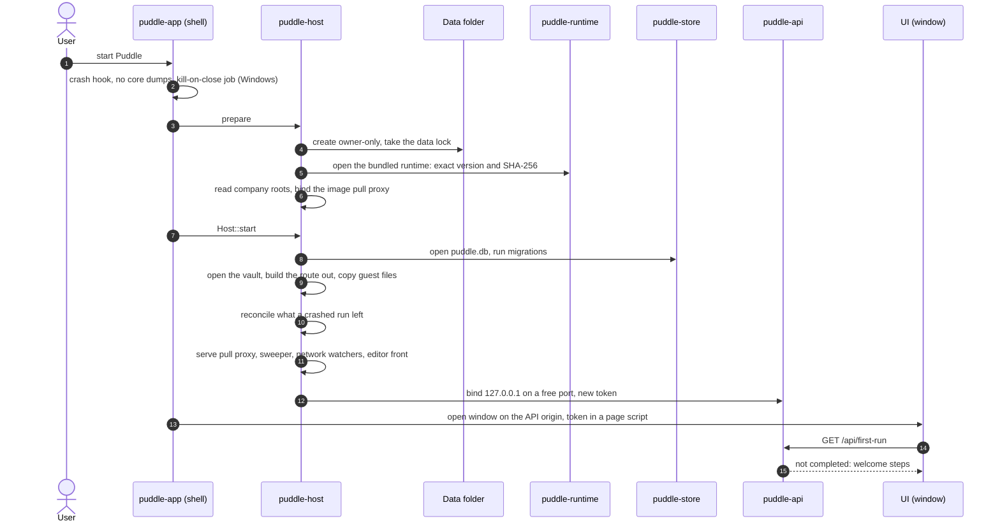
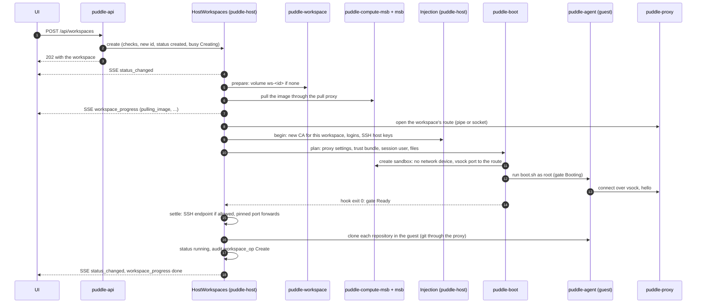
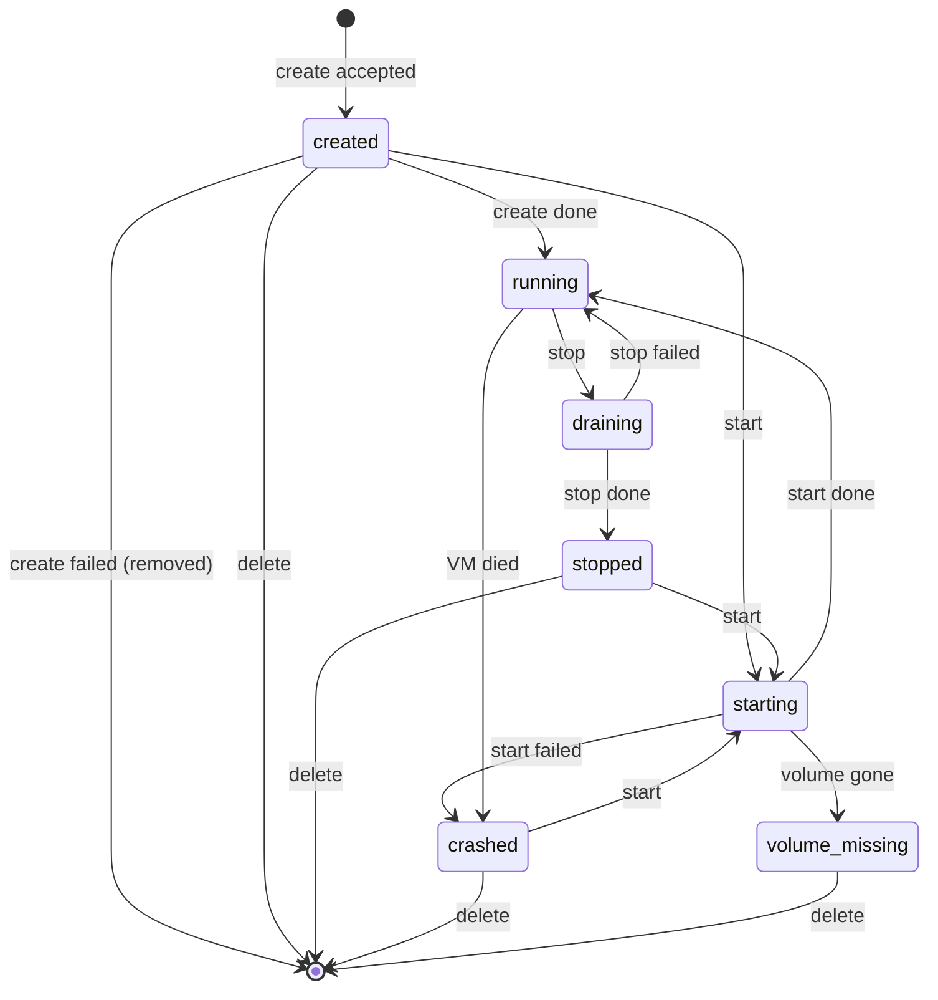
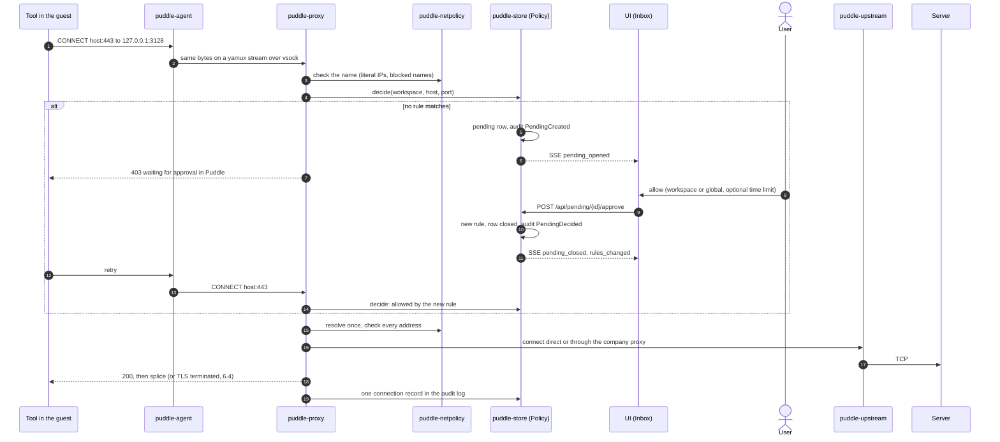
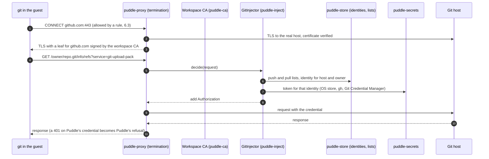
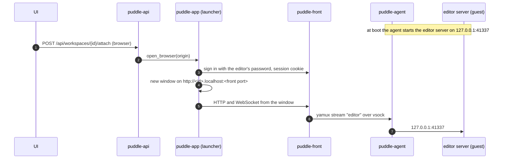
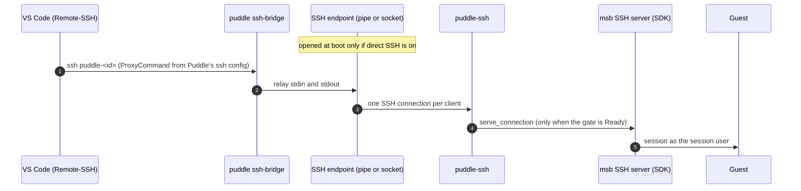
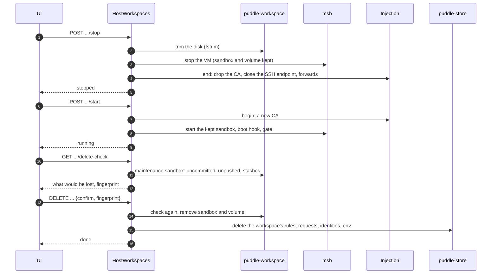

# 6. Runtime view

How the building blocks of section 5 work together in the scenarios that matter. Each scenario
names the function that does each step, so a reader can follow it in the code. The scenarios are:

- [6.1 First start](#61-first-start)
- [6.2 Create a workspace and boot its VM](#62-create-a-workspace-and-boot-its-vm)
- [6.3 An outbound request: rule, Inbox and approval](#63-an-outbound-request-rule-inbox-and-approval)
- [6.4 A git operation with a credential added](#64-a-git-operation-with-a-credential-added)
- [6.5 Open an editor](#65-open-an-editor)
- [6.6 Stop, start and delete](#66-stop-start-and-delete)
- [6.7 Quit](#67-quit)
- [6.8 Upgrade](#68-upgrade)
- [6.9 Crash and start-up errors](#69-crash-and-start-up-errors)

Paths are relative to the repository root. Function names are given where a file holds more than
one step.

## 6.1 First start

The desktop app is one process: the Tauri shell and the host run together, and the window shows the
UI that the host's local API serves.

1. **Process guards.** `crates/puddle-app/src/shell.rs` `run` installs the crash hook
   (`crates/puddle-app/src/crash.rs`), switches off core dumps and Windows Error Reporting
   (`crates/puddle-no-dump`), and on Windows puts the process in a kill-on-close job, so every VM
   process dies with Puddle (`crates/puddle-lifecycle/src/job.rs`).
2. **One instance.** The Tauri single-instance plugin is registered first: a second launch focuses
   the running window instead of starting a second host (`shell.rs` `on_second_start`). Under it,
   the data lock refuses a second host on the same data folder and names the holder's process id
   (`crates/puddle-fs/src/lock.rs`).
3. **Prepare** (`crates/puddle-host/src/host/steps.rs` `prepare`), before any thread starts: the data
   folder is created owner-only and locked, the open-file limit raised (`crates/puddle-fd-limit`), the
   loopback image pull proxy bound, the bundled runtime checked, the company roots read. The runtime
   check refuses a missing `msb`, a version other than the one Puddle was built for, or a file whose
   SHA-256 differs from the pinned one (`crates/puddle-runtime/src/runtime.rs`,
   `crates/puddle-runtime/src/digest.rs`). Nothing is unpacked: the runtime runs from the install
   folder (section 7).
4. **Start** (`crates/puddle-host/src/host.rs` `Host::start`, steps in `START_STEPS` of `steps.rs`):
   open the state (apply a restore the user confirmed earlier, open the store, which migrates the
   schema, load `workspaces.json`), open the credential vault, build the route out (company proxy
   discovery), copy the guest agent and boot scripts into the guest share
   (`crates/puddle-host/src/boot.rs` `BootKit::new`), empty Puddle's own SSH config, open the msb
   runtime, reconcile (6.9), then serve the background parts: pull proxy, the store's sweeper (one
   pass at start, then every minute), network watchers and the editor front.
5. **Local API.** `crates/puddle-host/src/host/serve.rs` binds the API on `127.0.0.1`, port 0 (the
   OS picks a free port), with a fresh token, and writes the URL and token to the owner-only
   `api.json` in the data folder. The log says "Puddle is up".
6. **Window.** `crates/puddle-app/src/window.rs` `open_main` opens the API's URL; the API serves the
   UI build embedded in the binary (`crates/puddle-api/src/ui.rs`). A page script hands the token
   to the page as a frozen `window.__PUDDLE__`, which `ui/src/lib/api/connection.ts` reads; the
   token never enters a guest.
7. **What the user sees first.** `ui/src/routes/+page.ts` asks `GET /api/first-run`: until the
   welcome flow is done the user goes to the step they were on (welcome, check, certificates,
   connect, interception, look, done: `ui/src/lib/welcome/steps.ts`); after it, to the workspace
   list. The check step runs `puddle doctor`'s checks through the API.

The `puddle` command line does not start a host and does not talk to a running one. `doctor`,
`backup`, `audit` and `user` work on the data folder directly; `secrets` takes the data lock and
refuses while a host runs (`crates/puddle/src/cmd/secrets.rs`). `puddle serve`, which would run a
host without a window, is a dormant cargo feature that release builds leave out
(`ci/check-dormant-release.sh`).

## 6.2 Create a workspace and boot its VM

1. **Request.** The create form (`ui/src/lib/components/CreateWorkspaceForm.svelte`) sends
   `POST /api/workspaces` with the repositories, image, memory and CPUs. The handler
   `create_workspace` (`crates/puddle-api/src/routes/workspaces.rs`) checks the repositories and
   their hosts, then calls the `WorkspaceService` trait (`crates/puddle-services`), which
   `HostWorkspaces::create` implements (`crates/puddle-host/src/workspaces/service.rs`). That draws an
   id, records the workspace as `created` and busy with `Creating`, saves the list, sends
   `status_changed` and hands the work to a background task. The API answers `202` at once.
2. **Volume and image** (`crates/puddle-host/src/workspaces/boot.rs` `boot_new`). Folders the user
   imported from the computer are copied onto the volume first. `Workspaces::prepare`
   (`crates/puddle-workspace/src/workspaces.rs`) creates the volume `ws-<id>` if there is none. The
   image is pulled by the runtime through Puddle's pull proxy (`crates/puddle-proxy/src/pull.rs`),
   which takes the same route out as guest traffic and audits the pull as Puddle's own.
3. **Route and identity.** `BootKit::route` (`crates/puddle-host/src/boot.rs`) opens a per-workspace
   pipe or Unix socket (`crates/puddle-ipc`) and has the proxy serve it
   (`crates/puddle-proxy/src/route.rs`). Every stream that arrives there belongs to this workspace;
   the guest never names itself. `Injection::begin` (`crates/puddle-host/src/injection.rs`) makes a
   new certificate authority for the workspace, in memory, on every start.
4. **Plan and sandbox.** `BootKit::plan` assembles what the guest gets: proxy settings for every
   common tool (`crates/puddle-guest-env`), the trust bundle with the company roots and the
   workspace CA (`crates/puddle-certs`), the session user, Git identity and editor settings.
   `BootKit::spec` builds the sandbox spec: memory, CPUs, a vsock port that leads to the route, the
   volume at `/workspace`, a root disk, a disk for Docker, and the boot files mounted under `/puddle/`
   (`crates/puddle-boot/src/assets.rs`). `crates/puddle-compute-msb/src/spec.rs` asserts that the
   sandbox has no network policy and switches the network device off.
5. **Boot hook and gate** (`crates/puddle-boot/src/hook.rs`). The hook opens the readiness gate as
   `Booting`, creates the sandbox, then runs `/puddle/boot.sh` as root with the plan on stdin: write
   the files, update the CA store, make the session user `agent`, start `puddle-agent` under a
   supervisor and wait until it listens, then run the image's own entrypoint. Exit 0 sets the gate
   to `Ready`; anything else sets `Failed` with the script's error output and stops the sandbox.
   Until the gate is `Ready`, nothing gets exec or SSH (`crates/puddle-boot/src/gate.rs`).
6. **Agent link.** The agent dials the host over vsock and keeps a small pool of yamux sessions
   (`crates/puddle-agent/src/upstream.rs`); on its control stream it says hello with its protocol
   version (`crates/puddle-agent-proto/src/host.rs`).
7. **Settle and clone** (`crates/puddle-host/src/workspaces/settle.rs`,
   `crates/puddle-host/src/workspaces/create_and_grow.rs`). The SSH endpoint opens only if direct SSH
   is on for the workspace; pinned port forwards come back. Each repository from the form is cloned
   inside the guest by `git clone` run as the session user, so the clone goes through the proxy and
   gets its credential like any other git command (6.4). A failed clone raises a problem and does not
   fail the workspace.
8. **Done.** `conclude` (`crates/puddle-host/src/workspaces/plumbing.rs`) moves the status to
   `running`, writes a `workspace_op` audit record, and sends `status_changed` and the progress step
   `done`. A failure after the sandbox was created undoes it: the VM is stopped and removed, and a
   volume this create made is deleted.

Progress reaches the UI as server-sent events on `GET /api/events`
(`crates/puddle-api/src/routes/events.rs`). Each frame is a JSON event whose `type` field names it
(`crates/puddle-types/src/event.rs`); the UI reads them in `ui/src/lib/api/sse.ts`. The progress
steps are `preparing_volume`, `pulling_image`, `unpacking_image`, `starting`, `syncing`, `cloning`,
then `done` or `failed`.

### Workspace states

The status a user sees (`WorkspaceStatus`, `crates/puddle-types/src/event.rs`) and the operation in
progress are kept apart: `crates/puddle-services/src/workspaces/phase.rs` holds the state machine as
`Idle(status)` or `Busy(operation, status)`, and only the transitions it admits happen.

Start and delete need a workspace that is down (`created`, `stopped`, `crashed` or
`volume_missing`); stop needs `running`. The status `paused` exists in the type but no operation in
this machine leads to it.

## 6.3 An outbound request: rule, Inbox and approval

Code in the VM opens a connection to a host. Nothing in the VM can reach the network, so every
connection is a request to Puddle's proxy, which decides on the name before it looks the name up.

1. **Into the agent.** At boot Puddle points every common tool at the agent's listener on
   `127.0.0.1:3128` (environment variables and config files for apt, Maven, Gradle, Docker and
   others: `crates/puddle-guest-env/src/render.rs`). Nested containers use the Docker bridge address.
   Tools that ignore proxy settings are caught by transparent capture: the agent's stub DNS answers
   with a stand-in address from `198.18.0.0/15` after asking the host about the name, and nftables
   redirects connections to those addresses to the agent, which turns them back into a `CONNECT` by
   name (`crates/puddle-agent/src/capture/`). The agent does not parse requests; it adds the origin
   and program as headers and relays bytes (`crates/puddle-agent/src/serve.rs`).
2. **Across the boundary.** Each connection is one yamux stream over vsock. It arrives on the
   workspace's route, so the host knows the workspace without trusting anything the guest says
   (`crates/puddle-agent-proto/src/host.rs`, `crates/puddle-proxy/src/route.rs`).
3. **Read the target** (`crates/puddle-proxy/src/proxy.rs` `serve`). A per-workspace stream cap
   answers `503` above it. The request head is read within a size and time bound and the host name
   normalised (`crates/puddle-netpolicy/src/name.rs`). `CONNECT` and absolute-form plain HTTP are
   accepted; plain HTTP is admitted per request (`crates/puddle-proxy/src/plain.rs`).
4. **Name guard, then rules** (`crates/puddle-proxy/src/proxy/admit.rs`). A literal address or a name
   that is blocked by itself (a local category that is off, Puddle's own endpoints) is refused here
   and never becomes a request in the Inbox (`crates/puddle-netpolicy/src/guard.rs`). Then the
   `Policy` trait (`crates/puddle-types/src/policy.rs`) asks the store. The store matches against an
   in-memory rule index and ranks matches by precedence, then pattern specificity, then workspace
   over global, then deny over allow (`crates/puddle-store/src/engine.rs`).
5. **No match.** The store records a pending request, or counts one more attempt on an open one for
   the same workspace, host and port, writes an audit record and sends `pending_opened` or
   `pending_updated` after the commit (`crates/puddle-store/src/store.rs` `record_pending`). The
   proxy answers at once: `403 Forbidden, waiting for approval in Puddle`, body
   "`<host>` is waiting for approval in Puddle; approve it there, then retry", headers
   `x-puddle-decision: pending` and `x-puddle-pending: <id>`. **The connection is not held open**:
   the tool gets the refusal with its reason and tries again later. A request never expires by age,
   so the Inbox keeps it until the user answers; a per-workspace cap on open requests bounds a flood
   without refusing anything new.
6. **The user's answer.** The Inbox calls `POST /api/pending/{id}/approve` or `.../deny`
   (`crates/puddle-api/src/routes/pending.rs`) with a scope (this workspace or every workspace), an
   optional rule set, whether subdomains are included, and an optional time limit (the UI offers one
   hour to seven days: `ui/src/lib/decision/model.ts`). A global answer needs the right to change
   global rules. `Store::resolve_pending` adds the rule, closes this request and every other open
   one the new rule decides, writes the audit records and swaps in a new rule index, all in one
   transaction. The tool's next try is decided by that index. There is no one-time allow for network
   requests: the shortest answer is a rule with a time limit.
7. **A rule already decides.** A deny is a `403` that names the rule (`x-puddle-decision: deny`,
   `x-puddle-rule`). An allow continues: the name is resolved once and every address is classified
   (`crates/puddle-netpolicy/src/classify.rs`). A private, loopback or link-local address needs its
   local category switched on and an exact allow; a blocked address is a `403` with
   `x-puddle-blocked` and a message that names the setting. If the store cannot answer, the proxy
   answers `503`: it fails closed.
8. **Route out** (`crates/puddle-proxy/src/upstream.rs` `connect_out`). Direct, to the checked
   addresses, or through the company proxy chosen by PAC, WPAD or the environment, with the user's
   sign-in where the proxy asks for it (`crates/puddle-upstream/src/chain.rs`). The proxy then either
   splices the bytes end to end or terminates TLS (6.4). Terminating never allows anything: the
   rules and the address guard have already run.
9. **Audit.** Every connection that reached a decision ends as one record (decision, reason, rule or
   request, the address connected to, bytes each way) in the store's audit log
   (`crates/puddle-store/src/recorder.rs`), which the Activity screen shows.

A captured connection (step 1) cannot read an HTTP answer, so its refusal is a TCP reset; an SSH
client gets the refusal text instead (`crates/puddle-agent/src/capture/listen.rs`). The agent waits
up to 60 seconds for the proxy's answer to a captured connection.

## 6.4 A git operation with a credential added

The guest never holds a token. Git in the guest talks to the real host through the proxy; for hosts
that have an identity the proxy terminates TLS, adds the credential and sends the request on.

1. **Which hosts are decrypted.** The workspace's termination set holds the hosts of its identities,
   secrets and captured logins (`crates/puddle-host/src/injection.rs`). Only port 443 to a name in
   that set is terminated, unless the user switched on decrypting every host (then any name is
   terminated); everything else is spliced (`crates/puddle-proxy/src/terminate/mod.rs`
   `Termination::mode_for`).
2. **TLS.** The proxy reads the guest's ClientHello (on a host with a credential, a name that does
   not match the `CONNECT` target is refused; on a host decrypted only because of the switch it is
   passed through), connects to the real server first, and answers the guest with a leaf signed by
   the workspace CA, which the boot hook put in the guest's trust bundle
   (`crates/puddle-proxy/src/terminate/session.rs`, `crates/puddle-ca/src/authority.rs`).
3. **Decide per request** (`crates/puddle-inject/src/injector.rs` `decide_git`). The path gives the
   repository and whether it is a push or a pull (`crates/puddle-inject/src/git_path.rs`). The
   workspace's push and pull lists are checked (a miss is a `403` and a `git_access_denied` event). A
   request that already carries `Authorization` passes unchanged. Otherwise the identity is chosen
   by host, then owner (`crates/puddle-store/src/identity.rs` `resolve`): one identity covers it (add
   its token, after checking the token's scope against host and organisation), none covers it (the
   request goes out without a credential, so public repositories work), or more than one could
   (`409`, the user must choose).
4. **Where the token comes from** (`crates/puddle-secrets/src/sources.rs`): the OS credential store,
   `gh auth token`, `git credential fill` (Git Credential Manager) or the Azure CLI, cached in memory
   (`crates/puddle-secrets/src/cache.rs`). If the source cannot give a token, a read goes out without one and a write is
   refused with `502`.

**Git over SSH.** A guest that runs `git clone git@github.com:...` does not get a tunnel to the
host's SSH port. When the target is port 22 of a known git host or of a host with an identity, the
proxy plays the SSH server itself, with host keys it keeps in memory
(`crates/puddle-proxy/src/ssh_git/session.rs`). It first admits the same name on port 443, so the
same rules apply; it accepts only `git-upload-pack` and `git-receive-pack`; it asks the same
`GitInjector` about an equivalent `info/refs` request, so push and pull lists and identity choice are
the same as over HTTPS; then it turns the pkt-line stream into smart-HTTP requests and sends them
through the workspace's own TLS termination (`crates/puddle-proxy/src/ssh_git/bridge.rs`,
`crates/puddle-proxy/src/ssh_git/https.rs`). The token is added there. SSH to any other host is
refused with a reason.

**Logins of tools.** Tools that sign in themselves (Claude Code, GitHub, Microsoft Entra, OpenAI Codex, Docker Hub) go through the same
termination. On a token endpoint, `crates/puddle-logins` (the `ExchangeRewriter` trait of
`crates/puddle-proxy/src/terminate/exchange.rs`) stores the real token in the OS store and gives the
tool a stand-in; later requests have the stand-in swapped for the real token on the way out. A token
endpoint on a connection that is not decrypted is refused, so the real token can never reach the
guest by accident.

## 6.5 Open an editor

### Browser editor

1. **The editor server runs before anyone opens it.** At boot the agent starts the editor server the
   host chose and restarts it if it dies (`crates/puddle-agent/src/editor.rs`); its password is new
   at every boot. code-server ships with Puddle and is mounted read-only at `/puddle/code-server`.
   Microsoft's VS Code server is chosen only if the user picked it and accepted Microsoft's terms in
   Puddle at the current terms version (`crates/puddle-settings/src/consent.rs`); the agent then
   downloads it through the proxy from Microsoft's update service and keeps it on the volume
   (`crates/puddle-agent/src/microsoft.rs`). The choice is read at each sandbox start.
2. **Open.** The UI calls `POST /api/workspaces/{id}/attach` with mode `browser`
   (`crates/puddle-api/src/routes/workspaces.rs`). The host computes the workspace's origin,
   `http://<id>.localhost:<front port>` (`crates/puddle-front/src/server.rs` `origin_of`). The desktop
   shell's launcher gets the editor password from the guest, signs in through the front, and opens
   a window on that origin with its own browser data folder (`crates/puddle-app/src/launcher.rs`). The
   password goes no further than that sign-in.
3. **Front** (`crates/puddle-front`). One listener on `127.0.0.1`, reachable from the computer only
   and registered as one of Puddle's own endpoints, so no workspace can reach it. It accepts only the
   host names `<id>.localhost` and `<port>.<id>.localhost` (the latter reaches a port in the guest for
   the editor's port links) and refuses foreign origins. It holds no credential of its own: the
   editor server's own login stays in force. Each request becomes a yamux stream with the `editor`
   preamble to the agent, which connects to the editor server in the guest
   (`crates/puddle-front/src/editor.rs`).

### Desktop VS Code over SSH

1. **Direct SSH is a per-workspace switch, off by default.** Turning it on shows a trust dialog once:
   a desktop editor's remote side can run code with the user's rights on the computer and read the
   editor's secrets (`ui/src/lib/workspaces/direct-ssh.ts`). While it is off, Puddle opens no SSH
   endpoint and writes no SSH config entry, and the API refuses a desktop attach.
2. **Endpoint and config.** At boot, `open_ssh` (`crates/puddle-host/src/workspaces/access.rs`) opens
   an owner-only endpoint: a named pipe whose access list holds only the current user on Windows, a
   socket file with mode `0600` in a `0700` folder on Linux (`crates/puddle-ipc`). Puddle writes one
   `Host puddle-<id>` entry into its own SSH config file in the data folder, and adds one `Include`
   line for that file at the top of `~/.ssh/config` the first time
   (`crates/puddle-host/src/ssh_config.rs`). The entry sets `ProxyCommand` to `puddle ssh-bridge`, a
   login key of Puddle's, no agent or X11 forwarding and a known-hosts file per workspace.
3. **Open.** The attach call with mode `desktop` starts VS Code with a
   `vscode-remote://ssh-remote+puddle-<id>` folder URI (`crates/puddle-host/src/vscode.rs`).
   `puddle ssh-bridge` relays the SSH bytes to the endpoint (`crates/puddle/src/cmd/ssh_bridge.rs`,
   `crates/puddle-ssh/src/bridge.rs`). `crates/puddle-ssh` gives each client its own SSH connection
   to the msb SDK's SSH server (`crates/puddle-compute-msb/src/sandbox.rs`), with no idle timeout.
   There is no `sshd` in the image.

**Port forwards.** The Ports tab forwards a guest port to a port on `127.0.0.1` of the computer over
the agent's `forward` stream, not over SSH, so forwards work with direct SSH off. Pinned forwards
come back at every start (`crates/puddle-ports`). The host also builds `Ports` with
`with_auto_forward` (`crates/puddle-host/src/host.rs`): each port the agent newly reports as
listening in a running workspace is forwarded to the same number on `127.0.0.1` when that number is
free, and closed again when the guest stops listening. A port the user closed is not reopened while
it keeps listening, a port with a pin is left to the pin, and a taken port is skipped without a
notice. The report is the guest's claim, so the guest decides which numbers are tried
(`docs/spec/ports-and-front.md`).

## 6.6 Stop, start and delete

- **Stop** (`crates/puddle-host/src/workspaces/start_stop_delete.rs` `stop_work`). The status turns
  `draining`. Terminals end and the browser window closes; the disk is trimmed so freed space goes
  back to the computer; the VM is stopped (a forced stop raises a problem). Then `quiesce`
  (`crates/puddle-host/src/workspaces/access.rs`) releases what belonged to the running VM: the
  forwards close (pins stay), the workspace CA and its TLS termination are dropped, the SSH endpoint
  closes and its config entry is withdrawn. The sandbox with its root disk and the volume stay.
- **Start.** A workspace that is down starts again in place: the kept sandbox is started with a new
  plan and a new CA (`restart_in_place`), and the boot hook and gate run as in 6.2. A sandbox left by
  an earlier Puddle run is adopted when its route matches. If the sandbox cannot be reused it is
  removed and a new one boots on the same volume; a volume that is gone gives `volume_missing` and
  is never recreated empty, because an empty volume would hide the loss of the user's work.
- **Delete** (`delete_work`). Only a workspace that is down can be deleted. First a short-lived
  maintenance sandbox mounts the volume and lists uncommitted changes, unpushed commits and stashes
  (`crates/puddle-workspace/src/workspaces.rs` `check_delete`); the UI shows them and sends back the
  fingerprint of what the user saw. The delete checks again and refuses if anything changed. Then
  the sandbox and the volume are removed (this is the only place a volume is deleted), and
  `Store::delete_workspace` (`crates/puddle-store/src/store/workspaces.rs`) deletes the workspace's rules
  (each with an audit record), closes its open requests, and deletes its identities, environment,
  stand-ins and forwards in one transaction; its secret values leave the credential store. Leftovers
  a failed step could not remove are retried at the next start (`sweep_retired`).
- **Audit.** Create and delete always write a `workspace_op` record; stop and start write one only
  when they fail.

## 6.7 Quit

`RunEvent::Exit` runs `shell::stop` (`crates/puddle-app/src/shell.rs`): editor windows close, each
guest is asked to end its editor's extension hosts (up to 10 seconds), then `Host::shutdown`
(`crates/puddle-host/src/host.rs`, `SHUTDOWN_STEPS` in `steps.rs`) runs in a fixed order:

1. refuse new workspace operations ("Puddle is shutting down") and give running ones a short grace;
2. trim and stop every VM in parallel, at most 30 seconds for the trim and 45 for the stop
   (`crates/puddle-lifecycle/src/shutdown.rs`); a disk that could not be trimmed is remembered and
   reported at the next start;
3. drop every workspace CA, close the SSH endpoints and routes;
4. stop the API, the sweeper, the pull proxy, the front and the watchers;
5. release the data lock last.

VMs are stopped, not removed: the next start finds the sandboxes and volumes as they were.

## 6.8 Upgrade

The Windows installer replaces the program files and leaves the data folder alone (section 7). It
refuses to run while Puddle or `msb` is running. The first start of the new version then does this:

- **Store.** The schema version is SQLite's `user_version`; the migrations are an append-only list
  (`crates/puddle-store/src/schema.rs`, `SCHEMA_VERSION`; the runner is `schema/migrations.rs`). Before migrating, the store writes a copy
  `puddle.db.pre-v<N>` (the last two are kept); all steps and the version bump run in one
  transaction, and a step that breaks a foreign key aborts it. A database from a newer Puddle is
  refused, and the app says that nothing in the data folder was changed
  (`crates/puddle-app/src/shell.rs`).
- **Going back.** What can be undone: the database, from the `puddle.db.pre-v<N>` copy, with an
  older Puddle installed (the MSI refuses a downgrade, so the new one is uninstalled first; the
  data folder stays). Everything written to the database since the upgrade is lost. What cannot:
  `workspaces.json` and the settings documents have no copy and are rewritten in the new format at
  their next save, and an older Puddle refuses a newer file; the `msb/` home has no copy either.
  Those come back only from a `puddle backup` taken before the upgrade. There is no command; the
  steps are in [docs/backup.md](../backup.md#going-back-after-a-bad-upgrade).
- **Workspace list.** `workspaces.json` carries a version; older versions are read and upgraded in
  memory, a newer one is refused as written by a newer Puddle (`crates/puddle-host/src/files.rs`).
- **Runtime.** The new `msb` ships in the new install folder and is checked like any start (6.1).
  The runtime's own home (`MSB_HOME`, the `msb/` folder of the data folder, section 7) is not part
  of the install and is reused as it is: the new `msb` opens the sandboxes, volumes and database
  the old one left there. The `puddle.db.pre-v<N>` copy covers Puddle's store, not this home; a
  layout change in it between two pinned `msb` versions is msb's own, and the only check is the
  MSI upgrade job with a workspace that has files (section 10).
- **Guest agent.** Every host start copies the installed agent into the guest share, so a workspace
  gets the new agent at its next start. A workspace still running the old agent is noticed through
  the agent's hello: the protocol mismatch shows as a problem that says to stop and start the
  workspace (`crates/puddle-host/src/agent_reports.rs`).

There is no update check in the app. The signed freshness file that a future update list would use
is built and re-signed daily (`crates/puddle-freshness`, `.github/workflows/freshness.yml`), but no
product code reads it, so Puddle makes no outbound call the user did not ask for.

## 6.9 Crash and start-up errors

**When Puddle dies.** On Windows the kill-on-close job ends every VM process with the shell; on Linux
the runtime's parent watchdog does (`crates/puddle-lifecycle/src/job.rs`). The work stays on the
volumes. A panic writes a crash report to `crashes/` in the data folder (or the temp folder if that
is not writable), keeping the newest few (`crates/puddle-app/src/crash.rs`); no core dump is written
and nothing is uploaded. A panic inside a background task ends that task, not the process.

**The next start reconciles** (`crates/puddle-lifecycle/src/reconcile.rs`, called from
`crates/puddle-host/src/host/reconcile.rs`) before it serves anything:

- Puddle-owned VMs that are still running are trimmed and stopped;
- sandbox records the workspace list does not claim are removed; a volume is removed only when its
  create never finished, and an unknown volume is kept and reported, because removing a user's data
  on a guess is worse than leaving a stray disk;
- each workspace's status is set from what was found (`crashed`, `volume_missing`), and the findings
  are raised as problems the UI shows;
- Puddle's SSH config file is emptied; deletes that did not finish are completed; half-made
  pre-migration copies are removed.

Pending requests are rows in the store and survive a crash like the rules do.

**Start-up errors.** Every failure while starting becomes a `HostError`
(`crates/puddle-host/src/error.rs`) with a sentence for the user. The app writes it to
`startup-error.txt` in the data folder and reports "Puddle did not start: `<reason>`" with the path
of that file (`crates/puddle-app/src/crash.rs`); a release build on Windows shows it in a message
box (`crates/puddle-app/src/main.rs`), elsewhere it goes to standard error. The common cases:

| Cause                                        | What happens                                                                                                                                                                  | Code                                                                      |
| -------------------------------------------- | ----------------------------------------------------------------------------------------------------------------------------------------------------------------------------- | ------------------------------------------------------------------------- |
| Second start                                 | The single-instance plugin focuses the running window; a second host on the same data folder is refused with the holder's process id                                          | `crates/puddle-app/src/shell.rs`, `crates/puddle-fs/src/lock.rs`          |
| Runtime missing, wrong version or wrong hash | Start refused; the message points to `puddle doctor`                                                                                                                          | `crates/puddle-runtime/src/runtime.rs`, `crates/puddle-host/src/error.rs` |
| Database from a newer Puddle                 | Start refused; nothing in the data folder changed                                                                                                                             | `crates/puddle-store/src/schema/migrations.rs`                            |
| Database unreadable                          | Start refused with the store's error; there is no repair step                                                                                                                 | `crates/puddle-store/src/store.rs`                                        |
| Port taken                                   | Cannot happen for the API and the pull proxy (the OS picks a free port). The editor front keeps its port across starts; if it is taken, it takes another and raises a problem | `crates/puddle-host/src/front.rs`                                         |
| No hypervisor (WHP or KVM)                   | Not checked at start: `puddle doctor` and the welcome check step test it and report it                                                                                        | `crates/puddle-doctor/src/diagnose.rs`                                    |

Problems found after the start (a VM that died, an out-of-memory kill in the guest, a disk nearly
full, a protocol mismatch) are not start-up errors: they are events and problems the UI shows
(`crates/puddle-types/src/event.rs`).
