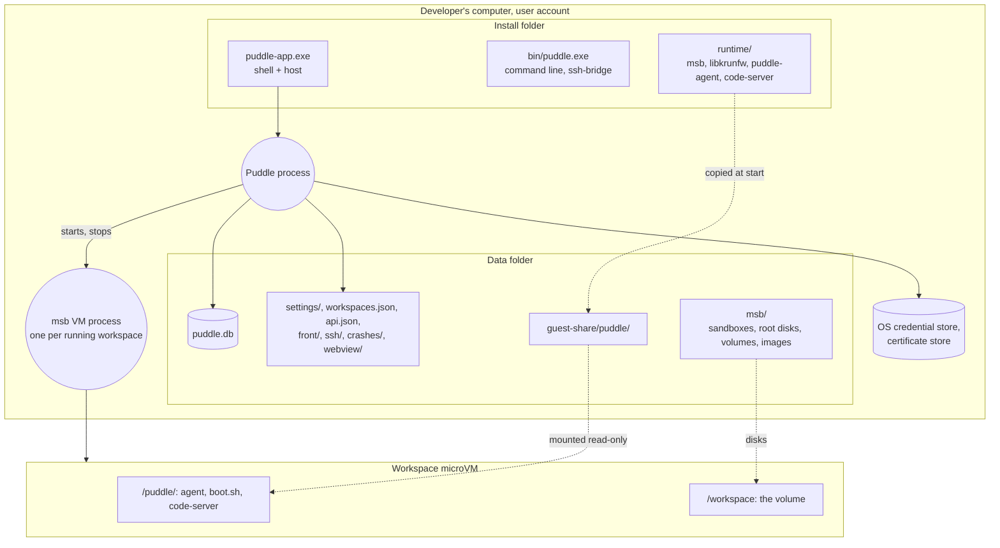
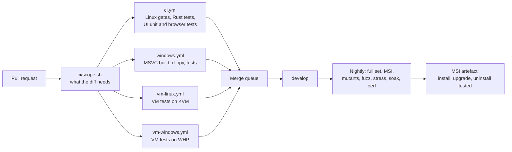

# 7. Deployment view

What gets installed where, what runs on which machine, and what Puddle writes to disk. Then the
build: how a commit becomes a tested installer. Paths are relative to the repository root unless
they are paths on the user's computer or in the guest.

## 7.1 One computer, one process, many VMs

Puddle has no server side. Everything runs on the developer's computer, under the developer's own
account, with no administrator rights and no service.

| Node                      | What runs there                                                                                                                                                                                                                                                                                  | Code                                                                      |
| ------------------------- | ------------------------------------------------------------------------------------------------------------------------------------------------------------------------------------------------------------------------------------------------------------------------------------------------ | ------------------------------------------------------------------------- |
| **Puddle process**        | The Tauri shell, the host (store, proxy, API, front, SSH endpoints) and every Puddle thread. One per data folder, enforced by an OS file lock. Started by the user or at sign-in; depending on a setting, closing the window leaves it running in the tray (`crates/puddle-app/src/desktop.rs`). | `crates/puddle-app`, `crates/puddle-host`, `crates/puddle-fs/src/lock.rs` |
| **msb VM processes**      | The bundled runtime runs one process per running sandbox, which hosts the VM through WHP (Windows) or KVM (Linux). On Windows they sit in Puddle's kill-on-close job; on Linux the runtime's parent watchdog ends them with Puddle.                                                              | `crates/puddle-compute-msb`, `crates/puddle-lifecycle/src/job.rs`         |
| **Workspace microVM**     | The workspace's image, Puddle's boot hook, the guest agent and the editor server. No network device: vsock is the only link to the host.                                                                                                                                                         | `crates/puddle-boot`, `crates/puddle-agent`                               |
| **`puddle` command line** | Short-lived. `doctor`, `backup`, `audit`, `user` and `secrets` work on the data folder; `ssh-bridge` is the SSH `ProxyCommand` that desktop editors start.                                                                                                                                       | `crates/puddle`                                                           |

There is no Windows service and no system daemon: nothing of Puddle runs while the user is signed
out, and nothing needs elevation. The only machine-wide prerequisite is the hypervisor (7.6).

## 7.2 Windows

Windows is the first supported host.

**Installer.** A per-user MSI (`Puddle_<version>_x64_en-US.msi`), built by `ci/build-msi.sh` from
the WiX template `crates/puddle-app/wix/main.wxs`:

- installs into `%LOCALAPPDATA%\Programs\Puddle` with `InstallScope="perUser"`, so no
  administrator rights are asked; a Start menu shortcut, no desktop shortcut, no change to `PATH`;
- carries `puddle-app.exe`, `bin\puddle-<target>.exe` (the command line) and `runtime\` (7.4);
- refuses to install or upgrade while `puddle-app.exe` or `msb.exe` runs, and asks the user to quit
  Puddle from its tray icon;
- upgrades in place (`MajorUpgrade`) and refuses a downgrade;
- needs the WebView2 runtime and fails with a message when it is missing; it ships no bootstrapper
  (`crates/puddle-app/tauri.conf.json`, `webviewInstallMode: skip`);
- on uninstall removes the start-at-sign-in entry; it never touches the data folder.

The MSI is not signed yet: no workflow or script signs it.

**What Windows gives Puddle.**

| Need                      | From                                                                                                        | Code                                           |
| ------------------------- | ----------------------------------------------------------------------------------------------------------- | ---------------------------------------------- |
| Hypervisor                | Windows Hypervisor Platform, probed with `WHvGetCapability`                                                 | `crates/puddle-doctor/src/sys/windows.rs`      |
| Window                    | WebView2, with an environment of Puddle's own that never uploads crash dumps                                | `crates/puddle-app/src/webview_environment.rs` |
| Secrets                   | Windows Credential Manager, `gh`, Git Credential Manager                                                    | `crates/puddle-secrets`                        |
| Company proxy and sign-in | WinINet and WinHTTP settings, PAC and WPAD, policy; SSPI for Negotiate and NTLM                             | `crates/puddle-upstream`                       |
| Company roots             | The `Root` and `CA` stores: the roots an administrator or the user added, minus the disallowed ones         | `crates/puddle-certs/src/store.rs`             |
| Owner-only endpoints      | Named pipes `\\.\pipe\puddle-<install id>-<workspace>` with an access list that holds only the current user | `crates/puddle-ipc`                            |
| VMs die with Puddle       | A kill-on-close job object                                                                                  | `crates/puddle-lifecycle/src/job.rs`           |
| No crash dumps            | Windows Error Reporting excludes Puddle's executables                                                       | `crates/puddle-no-dump`                        |

## 7.3 Linux and macOS

**Linux** builds and is tested in CI on every pull request (unit tests, and the VM tests on KVM
runners), but no Linux package is built yet: there is no `.deb`, `.rpm` or AppImage in the
repository's build scripts. Linux hosts are planned for a later release (`README.md`). The code
paths already exist: KVM through `/dev/kvm`, owner-only Unix sockets (`0600` in a `0700` folder),
the Secret Service for the credential store, proxy settings from the environment, and the runtime's
parent watchdog in place of the job object. Two pieces are Windows-only so far: reading company roots
from the system (the snapshot is empty on other hosts, `crates/puddle-certs/src/lib.rs`) and adding
the development certificate to the user's trust store (7.5).

**macOS** is kept possible and not supported. The runtime's file table has a macOS row
(`msb` and `libkrunfw.5.dylib`, `crates/puddle-runtime/src/platform.rs`), but no runtime folder is
built for it, and `puddle doctor` reports the hypervisor check as not supported yet
(`crates/puddle-doctor/src/diagnose.rs`). A `macos.yml` workflow runs the doctor's macOS-specific
tests only.

## 7.4 The bundled runtime and the guest files

The install folder's `runtime/` holds everything the VMs need, pinned at build time:

| File                               | What it is                                                     | Where it goes                                                                    |
| ---------------------------------- | -------------------------------------------------------------- | -------------------------------------------------------------------------------- |
| `msb.exe` / `msb`                  | The microVM runtime, from Puddle's public fork of microsandbox | Run from the install folder, never unpacked                                      |
| `libkrunfw.dll` / `libkrunfw.so.5` | The guest kernel as a library, from Puddle's fork of libkrunfw | Beside `msb`                                                                     |
| `puddle-agent`                     | The guest agent, a static Linux (musl) program                 | Copied to the guest share at every host start, mounted at `/puddle/puddle-agent` |
| code-server release                | The open-source browser editor server                          | Linked or copied to the guest share, mounted read-only at `/puddle/code-server`  |
| Licences and third-party notices   | What the bundled programs require                              | Stay in the install folder                                                       |

At every start Puddle checks that `msb` is exactly the version it was built for and that its SHA-256
matches the pinned value in `ci/msb-runtime.sha256` (`crates/puddle-runtime`); the user's own `MSB_*`
environment variables are ignored, so a different runtime on the machine cannot be picked up. The
guest is `x86_64`; an `aarch64` guest is named in the code but not built.

The boot files (`boot.sh`, `agent-supervise.sh`) and the agent are mounted into every VM under
`/puddle/`, read-only, from the data folder's `guest-share/puddle/` (`crates/puddle-boot/src/assets.rs`,
`crates/puddle-host/src/boot.rs`). Puddle adds nothing to the image itself.

**The image.** Puddle ships no base image. A workspace boots the image the user or the team names;
the default, and the image of the short-lived maintenance VMs (delete checks, imports), is
`mcr.microsoft.com/devcontainers/base:debian`, pinned by digest
(`crates/puddle-workspace/src/workspaces.rs`). A weekly pull request refreshes the pin
(`.github/workflows/refresh-image-pins.yml`, `ci/image-pins.sh`). The runtime pulls images through
Puddle's loopback pull proxy, so a pull takes the same route out (company proxy included) as
everything else.

## 7.5 The data folder

One folder per user, owner-only (an access list with only the current user on Windows, `0700` on
Linux): `%LOCALAPPDATA%\puddle` on Windows, `$XDG_DATA_HOME/puddle` (normally
`~/.local/share/puddle`) on Linux (`crates/puddle-fs/src/data_dir.rs`). Paths inside it are named in
`crates/puddle-host/src/paths.rs`.

| Path                            | Holds                                                                                                                                             |
| ------------------------------- | ------------------------------------------------------------------------------------------------------------------------------------------------- |
| `puddle.db`                     | SQLite store: rules, pending requests, the audit log, identities and repository lists, users; `puddle.db.pre-v<N>` copies from before a migration |
| `settings/`                     | The versioned global settings and per-workspace overrides, recorded consents                                                                      |
| `workspaces.json`               | The workspace list, versioned                                                                                                                     |
| `api.json`                      | The local API's URL and bearer token, for local clients                                                                                           |
| `front/`                        | The editor front's port, kept across starts, and its key halves for Microsoft's editor server                                                     |
| `ssh/`                          | Puddle's SSH config (one entry per workspace with direct SSH on), the login key, known-hosts files per workspace                                  |
| `guest-share/puddle/`           | The agent, boot scripts and code-server, as mounted into every VM                                                                                 |
| `msb/`                          | The runtime's own home: its configuration and database, the sandboxes with their logs and, in the runtime's own layout, disks and images          |
| `webview/`                      | Browser data of the editor windows                                                                                                                |
| `crashes/`, `startup-error.txt` | Crash reports (newest few) and the last start-up error                                                                                            |
| `dev-cert/`                     | The localhost development certificate (see below)                                                                                                 |
| lock and holder files           | The single-host lock and the process id that holds it                                                                                             |

**Disks of a workspace.** Each workspace has a volume `ws-<id>` mounted at `/workspace` (32 GiB
default, `crates/puddle-workspace/src/workspaces.rs`), which outlives every VM and is deleted only by
an explicit delete; a sparse root disk (16 GiB) that keeps what is installed outside the volume
across stops; and a disk for Docker inside the VM (20 GiB) (`crates/puddle-host/src/boot.rs`). Disks
are trimmed on stop and quit so freed space goes back to the computer.

**Not in the data folder.** Secret values (tokens, captured logins, workspace secrets) are in the OS
credential store, never on disk in the folder. The per-workspace certificate authority's key exists
only in the host's memory and is made new at every VM start (`crates/puddle-ca`). The desktop app
writes no log file: it logs to standard error (`crates/puddle-app/src/shell.rs`). `puddle backup`
copies the database, settings and workspace list, not the volumes and not the credential store
(`crates/puddle/src/cmd/backup.rs`).

**Outside the data folder.** Two things, both on the user's request: an `Include` line at the top of
`~/.ssh/config` for Puddle's SSH config, written the first time a workspace gets direct SSH
(`crates/puddle-host/src/ssh_config.rs`); and on Windows the localhost development certificate in the
current user's `Root` store, after one Windows confirmation from the welcome flow. That certificate
is a leaf for loopback names that cannot sign anything, so a server in a workspace can serve HTTPS
to the host's browser on a forwarded port without a certificate authority key existing anywhere
(`crates/puddle-certs/src/devcert/mod.rs`).

## 7.6 Ports, endpoints and certificates

| Endpoint             | Where                                                                           | Who can reach it                                             | Code                                                  |
| -------------------- | ------------------------------------------------------------------------------- | ------------------------------------------------------------ | ----------------------------------------------------- |
| Local API            | `127.0.0.1`, a port the OS picks at every start                                 | Local clients with the bearer token; Host and Origin checked | `crates/puddle-api/src/server.rs`                     |
| Editor front         | `127.0.0.1`, a port picked once and kept in `front/`                            | The editor windows, as `<id>.localhost:<port>`               | `crates/puddle-front`                                 |
| Image pull proxy     | `127.0.0.1`, a port the OS picks, with a token per run                          | The runtime's registry client                                | `crates/puddle-proxy/src/pull.rs`                     |
| Port forwards        | `127.0.0.1:<port the user chose>`                                               | Anything on the computer                                     | `crates/puddle-ports`                                 |
| Workspace route      | A named pipe or Unix socket per workspace; the VM reaches it as vsock port 5000 | That workspace's VM only                                     | `crates/puddle-ipc`, `crates/puddle-host/src/boot.rs` |
| SSH endpoint         | A second pipe or socket per workspace, only with direct SSH on                  | The current user (`puddle ssh-bridge`)                       | `crates/puddle-ipc`, `crates/puddle-ssh`              |
| Guest proxy listener | `127.0.0.1:3128` in the guest (and `172.17.0.1:3128` for nested containers)     | Processes in the VM                                          | `crates/puddle-agent/src/config.rs`                   |

All of Puddle's own listeners are registered with the proxy as Puddle endpoints, so a guest cannot
reach them even by a name that resolves to loopback (`crates/puddle-netpolicy/src/guard.rs`).

| Certificate                | Made                                 | Kept                           | Trusted by                                     |
| -------------------------- | ------------------------------------ | ------------------------------ | ---------------------------------------------- |
| Workspace CA               | At every VM start, one per workspace | Host memory only               | That workspace's guest (its CA bundle)         |
| Company roots              | By the company                       | The host's certificate store   | Every guest (copied into its CA bundle)        |
| Localhost development leaf | Once per user, valid 365 days        | `dev-cert/` in the data folder | The host's browser (Windows user `Root` store) |

## 7.7 The build as a deployment

Every change reaches `develop` through a pull request and the merge queue, and is proven on
GitHub-hosted runners: `ubuntu-24.04` (with KVM) and `windows-2025` (with WHP). The workflows are in
`.github/workflows/`.

| Workflow                                                                                 | Runs on                                            | What it proves                                                                                                                           |
| ---------------------------------------------------------------------------------------- | -------------------------------------------------- | ---------------------------------------------------------------------------------------------------------------------------------------- |
| `ci.yml`                                                                                 | Pull requests, queue, `develop`, nightly           | Repository gates, Rust tests with coverage, the UI's checks and browser tests                                                            |
| `windows.yml`                                                                            | Pull requests, queue, nightly                      | Windows build with MSVC, clippy and tests; a release build nightly and on pull requests to `main`                                        |
| `vm-linux.yml`, `vm-windows.yml`                                                         | Pull requests, queue, nightly                      | Real microVMs on KVM and WHP (`crates/puddle-vm-tests`)                                                                                  |
| `msi.yml`                                                                                | Nightly, installer changes, by hand                | Builds the MSI, installs it, upgrades from the last kept MSI with a workspace in place, drives the app through UI Automation, uninstalls |
| `webkit.yml`, `macos.yml`                                                                | Scheduled or on change                             | The UI in WebKit; the doctor's macOS checks                                                                                              |
| `real-tools.yml`, `live-contracts.yml`, `lab-forgejo.yml`, `company-network-windows.yml` | Scheduled or by hand                               | Real tools through the proxy, contracts with live services, a git host lab, company proxy fixtures on Windows                            |
| `mutants.yml`, `fuzz.yml`, `stress.yml`, `soak.yml`, `soak-windows.yml`, `perf.yml`      | Pull requests (mutants, changed lines) and nightly | Test strength, parser robustness, load and long runs                                                                                     |
| `freshness.yml`                                                                          | Daily                                              | Re-signs the freshness file (Ed25519) on its own branch                                                                                  |
| `fork-upkeep.yml`, `refresh-image-pins.yml`                                              | Weekly                                             | Replays the forks' patches on their upstreams; refreshes the image pin                                                                   |

**What the scope step does.** `ci/scope.sh` turns the changed paths into one switch per job and runs
everything when in doubt. Repository variables change the split between pull request, merge queue
and nightly: with `PUDDLE_LIGHT_CI=on`, pull requests and queue runs take only the unit tier and the
full set runs on every push to `develop` and when dispatched by hand. Whatever the split, every
check name still reports, so the required checks stay the same.

**Dependencies built elsewhere.** `msb` and `libkrunfw` come from the release jobs of Puddle's public
forks (microsandbox, libkrun, libkrunfw, russh, imago), pinned by tag in `Cargo.toml` and by hash in
`ci/msb-runtime.sha256`; `ci/fetch-msb.sh` can build a Linux `msb` from source when no asset is
pinned. Release builds may not switch on the dormant `serve` or `mise` features
(`ci/check-dormant-release.sh`).

**Releases.** There is no release workflow yet: nothing publishes a GitHub release, and nothing
signs the MSI. The MSI exists as a workflow artefact of `msi.yml` (kept 14 days), and the upgrade
test falls back to the MSI kept from `develop` because no release has been published
(`ci/fetch-baseline-msi.sh`). `main` holds released versions only (`CONTRIBUTING.md`).
