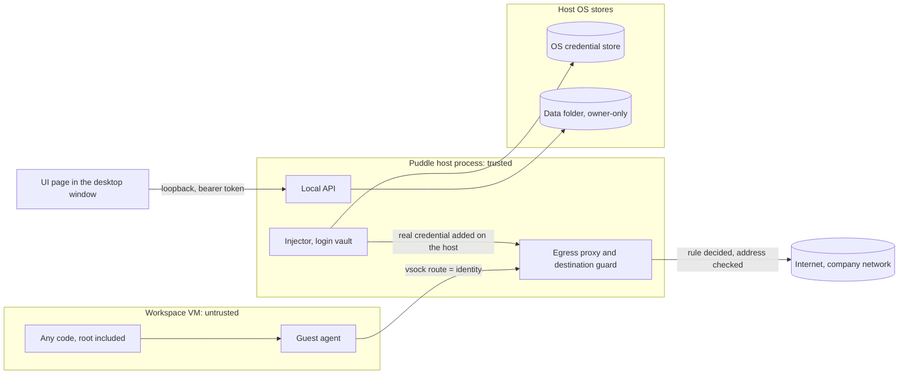

# 8. Cross-cutting concepts

Concepts that apply across many building blocks: the security and secrets model, identity, audit,
persistence and migrations, error handling, observability, configuration, testing, API and wire
types, accessibility and performance budgets. Each subsection says what the rule is, why, and which
code owns it. [docs/STANDARDS.md](../STANDARDS.md) stays the source for the coding, testing and CI
rules; this page names them and shows how they fit together.

## 8.1 Security and secrets model

Puddle protects three things: the user's credentials, the user's machine and network from code in a
workspace, and the user's control over what leaves. The model rests on four trust zones.

**The workspace is untrusted and holds no keys.** Code in a workspace may be hostile and may be root
in the guest. Its only way out is the vsock route to a per-workspace endpoint on the host, and the
endpoint a connection arrives on is the workspace's identity; nothing the guest says changes it
(`crates/puddle-ipc/src/lib.rs`). The endpoints are owner-only (a protected access list on Windows,
`0600` sockets in `0700` folders on Unix) with random or install-specific names. The proxy fails
closed: when the policy cannot be read it answers `503` (`crates/puddle-proxy/src/lib.rs`). Before
any rule is asked, `crates/puddle-netpolicy` blocks IP literals, `localhost` and cloud metadata
names; after resolution it checks every address against its class (loopback, private, link-local,
company network, Puddle's own listeners). Local categories are off by default, and with one switched
on only an exact allow reaches it, so a broad suffix rule can never open the user's LAN by accident.

**Credentials stay on the host.** Puddle never puts a real credential into the guest's environment,
files or memory, because anything the guest holds the guest can send anywhere. Instead:

- Git and HTTP credentials are added by the injector to a decrypted request on the host
  (`crates/puddle-inject`), for the repositories the matching identity covers.
- Logins captured in the guest (`gh`, `claude`, `copilot`) are swapped for stand-ins; the real
  tokens go to the OS credential store, and the proxy swaps them back only toward that service's own
  hosts (`crates/puddle-logins`).
- Environment secrets reach the guest as stand-ins too; the real value lives only in the proxy's
  registry (`crates/puddle-host/src/environment.rs`).
- Repository listing uses tokens on the host only (`crates/puddle-repos`).

**Where secrets are kept.** `crates/puddle-secrets` reads from three sources: the `gh` account
token, `git credential fill`, and tokens the user pasted, which it keeps in the OS store through the
`keyring` crate (Credential Manager on Windows with local, non-roaming persistence; Secret Service
on Linux; Keychain on macOS). A host with no usable OS store falls back to an AES-256-GCM file vault
whose key comes from a systemd credential or an owner-only key file. The choice is made once per
install and recorded in `<data>/secrets/store.json`. SQLite holds no secret values, only ids that
point into the store (`crates/puddle-store/src/schema.rs`). In memory, `Secret` and `ApiToken`
redact themselves in `Debug`, have no `Display` or `Serialize`, and are zeroed on drop.

**TLS termination keys never touch disk.** Each running workspace gets its own certificate authority,
created in host memory, path length 0, its key not exportable, and dropped when the workspace stops
(`crates/puddle-ca`). Only the public certificate enters the guest's trust bundle. A stolen leaf
certificate is therefore worth nothing outside that one workspace and that one run.

**The local API.** The API listens on `127.0.0.1` on a port the OS picks
(`crates/puddle-api/src/server.rs`). Every request passes three checks in order
(`crates/puddle-api/src/auth.rs`): the `Host` header must be the loopback address or `localhost`
with the API's port (`421` otherwise; this stops DNS rebinding), an `Origin`, if sent, must be the
API's own origin (`403`; no CORS), and a bearer token must match (`401`; compared in constant time).
The token is 32 random bytes, new at every start (`crates/puddle-api/src/token.rs`). State changes
use only `POST`, `PUT` and `DELETE` with `application/json` bodies, so a cross-site form or image
request cannot reach them. Authorization is one route table in `crates/puddle-api/src/authz.rs`: a
route missing from it is refused, and another user's resource answers as if it did not exist.

How a client gets the token:

- **The desktop window** gets it from a Tauri initialisation script that sets a frozen
  `window.__PUDDLE__`, and only when the page's origin is the API's own
  (`crates/puddle-app/src/window.rs`). The UI reads it from there and never from a URL, cookie or
  browser storage (`ui/src/lib/api/connection.ts`).
- **The connection file** `<data>/api.json` holds `{version, url, token}`. Every host writes it
  after binding the API: `HostConfig::new` sets it by default (`crates/puddle-host/src/config.rs`),
  so the desktop app writes it as well as `puddle serve`, and `crates/puddle-host/src/host/serve.rs`
  calls `ConnectionInfo::write`. The write goes through `puddle_fs::private::write_atomic`: a
  random-named temporary file created owner-only (`0600` on Unix, a protected access list with one
  entry for the current user on Windows), synced, then renamed into place. The reader refuses a file
  that others can read. Nothing deletes it at quit; the next start overwrites it, and a backup leaves
  it out. In the product its readers are developer tools (the UI's `npm run dev` proxy, the end-to-end
  and soak harnesses); the `puddle` command line does not read it.

**The desktop window** has one Tauri permission, the folder picker
(`crates/puddle-app/capabilities/main.json`), keeps navigation on the API's origin and denies new
windows (`crates/puddle-app/src/window.rs`). The API serves the UI with a strict Content Security
Policy (scripts by hash, no objects, no framing) and `X-Frame-Options: DENY`
(`crates/puddle-api/src/ui.rs`), and the UI has no HTML injection sinks (a quality-gate rule).

**Files on disk.** `crates/puddle-fs/src/private` is the one module that knows how each OS says "only
this user". The connection file, the database, the settings files, the workspace list and the
per-run endpoint folders all go through it, and start-up repairs or refuses a data folder others can
read (`crates/puddle-host/src/data_folder.rs`).

**Memory.** `crates/puddle-no-dump` stops the host process from being dumped or traced
(`PR_SET_DUMPABLE` 0 on Linux, a Windows Error Reporting exclusion on Windows), because a dump would
hold decrypted traffic and tokens. `PUDDLE_ALLOW_DUMPS=1` turns this off for debugging.

**In the repository.** `scripts/check-secrets.sh` runs gitleaks on every push and over the history in
CI. Test credentials are canary values that the allowlist in `.gitleaks.toml` names exactly, and
tests that handle a credential assert that the canary never shows up in a log, error, audit record
or the guest's view.

_Owned by:_ `puddle-ipc`, `puddle-netpolicy`, `puddle-proxy` (route identity, destination guard),
`puddle-inject`, `puddle-logins`, `puddle-secrets`, `puddle-ca`, `puddle-api` (`auth.rs`, `authz.rs`,
`token.rs`, `ui.rs`), `puddle-fs` (`private`), `puddle-no-dump`, `puddle-app` (`window.rs`,
`capabilities/`). Background: [principles 4 and 8](../principles.md), section 4.2.

## 8.2 Identity: ids and names

**Ids key everything; names are display text.** A workspace's id is 8 characters of lower-case
Crockford base32 from 40 random bits, starting with a letter, so it is a valid DNS label
(`WorkspaceId` in `crates/puddle-types/src/name.rs`). It never changes and is never reused. The id
names the sandbox, the volume (`ws-<id>`), the per-workspace settings file, rule scopes, events and
the editor's host name. The name the user types (`DisplayName` in
`crates/puddle-services/src/workspaces.rs`: 1 to 60 characters, trimmed, no control characters) keys
nothing, so a rename is a cheap metadata change: it keeps the volume and the sandbox and restarts
nothing. Nothing of the name goes into the id, so a name with spaces, accents or a word a filesystem
rejects can never break a path or a VM name.

| Thing                 | Id                                         | Where                                      |
| --------------------- | ------------------------------------------ | ------------------------------------------ |
| Workspace             | `WorkspaceId`, 8 random Crockford chars    | `crates/puddle-types/src/name.rs`          |
| Repository entry      | `EntryId`, same form, unique per workspace | `crates/puddle-types/src/name.rs`          |
| Rule, pending request | `RuleId`, `PendingId` (`i64` row ids)      | `crates/puddle-types/src/policy.rs`        |
| Git identity          | `IdentityId` (`i64`)                       | `crates/puddle-store/src/identity.rs`      |
| User, device          | `UserId`, `DeviceId` (`i64`)               | `crates/puddle-store/src/users.rs`         |
| Stored credential     | `<kind>-<128-bit hex>`                     | `crates/puddle-services/src/stored_ids.rs` |

**On the wire** every path, query parameter, event and rule scope uses the id
(`/api/workspaces/{id}`, `/api/workspaces/{id}/repositories/{entry}`, `/api/rules/{id}`); a rename is
`PATCH /api/workspaces/{id}` and changes `name` only (`crates/puddle-services/src/wire/workspaces.rs`).
The command line and typed input accept either the exact id or the name, matched case-insensitively.

**Uniqueness of names** is a usability rule, not an identity rule. Workspace names are unique per
owner, case-insensitively, checked in code (`crates/puddle-services/src/workspaces.rs`), because the
workspace list lives in `<data>/workspaces.json`, not in SQLite. Names in the database carry
case-insensitive unique indexes: identity labels, rule set names and user names
(`crates/puddle-store/src/schema.rs`).

**Names in history.** The audit log keeps the workspace's name as it was when each record was
written (`workspace_names`, copied into each row), so a renamed or deleted workspace still reads
the way the user knew it.

**Git identity** is a separate concept: a commit author (name and email) plus credential bindings,
each saying which hosts, owners or organisations it covers (`crates/puddle-store/src/identity.rs`).
Identities attach to a workspace in order, two with overlapping coverage cannot attach to the same
workspace, and the injector picks the one that covers the repository's owner.

_Owned by:_ `puddle-types` (`name.rs`, `policy.rs`), `puddle-services` (`workspaces.rs`,
`stored_ids.rs`), `puddle-store` (`identity.rs`, `users.rs`). Background:
[ADR 0006](../adr/0006-workspace-storage.md).

## 8.3 Audit log

The audit log (the UI and `puddle audit` call it the activity log) is a product feature, not a log
level: it is what lets the user see what each workspace reached and what changed the rules. It is
not a `tracing` target, and it has its own schema and tests.

**What is recorded** (`AuditRecord` in `crates/puddle-store/src/audit.rs`):

- every connection decision, with host, port, resolved address, upstream hop, decision, outcome,
  reason, rule and rule set, method, path without its query, protocol (HTTP or Git over SSH), Git
  operation and bytes up and down;
- pending requests created, decided, expired or suppressed;
- rule and rule set changes, and changes to the system-managed hosts;
- workspace operations: create, delete, rename, start, stop, identity, repository and SSH agent
  events, and retention changes and prunes.

Settings changes are not audited. User management writes to a separate `admin_audit` table.

**What is never recorded**: no field can hold a header, a body, a query string or a credential
value. Credential fields carry kinds and ids only. Each record is one JSON line made in one place
(`to_line`), capped at 4096 bytes with each string field capped at 1024. The JSON Lines format is a
public contract for scripts and exports ([ADR 0002](../adr/0002-wire-format-and-types.md)).

**How it is written.** The proxy writes through the `ConnectionLog` trait
(`crates/puddle-types/src/connection.rs`), which the store's `ConnectionRecorder` implements
(`crates/puddle-store/src/recorder.rs`), so the proxy does not depend on the store. A record that
fails to write is dropped and raises the `connection-records` problem until a write succeeds again;
the proxy never stalls a connection on the audit log. Connection records are limited to 200 per
workspace per second, with a summary record that counts what was left out, so a guest in a loop
cannot flood the database.

**Retention.** Records are deleted by age only: 90 days by default, up to 3650, set by the user
(`crates/puddle-store/src/store/audit_retention.rs`). The sweeper prunes at most once an hour in
chunks and writes an `AuditTrimmed` record. Past 2 GiB Puddle raises the `audit-size` warning and
deletes nothing on its own, because silently dropping history is worse than a big file. The other
deletion is the merge of more than 5000 waiting connection records of one workspace into one summary
(`crates/puddle-store/src/store/audit.rs`).

**How it is read.** `GET /api/audit` pages and filters (workspace, type, outcome, host, free text,
time); a user reads only their own records (`crates/puddle-api/src/routes/audit.rs`). Reads use a
separate read-only database connection, so a long scan never blocks the writer. The Activity screen
(`ui/src/routes/activity/`) can export the filtered records as NDJSON. `puddle audit status|prune`
works beside a running host (`crates/puddle/src/cmd/audit.rs`).

_Owned by:_ `puddle-store` (`audit.rs`, `recorder.rs`, `store/audit.rs`, `store/audit_retention.rs`,
`sweeper.rs`), `puddle-api` (`routes/audit.rs`). Section 6.3 follows one connection into the log.

## 8.4 Persistence and migrations

**What is stored where** (paths from `crates/puddle-host/src/paths.rs`, all under the data folder):

| Data                                                      | Form                                                    | Owner                             |
| --------------------------------------------------------- | ------------------------------------------------------- | --------------------------------- |
| Rules, pending requests, audit, identities, users, env    | SQLite `puddle.db`                                      | `puddle-store`                    |
| Workspace list                                            | `workspaces.json`                                       | `puddle-host` (`files.rs`)        |
| Global and per-workspace settings                         | `settings/global.json`, `settings/workspaces/<id>.json` | `puddle-host`, `puddle-settings`  |
| Secret values                                             | OS credential store or vault                            | `puddle-secrets`, `puddle-logins` |
| Workspace files                                           | msb disk volume `ws-<id>` under Puddle's private `msb/` | `puddle-compute-msb`              |
| API connection file, restore staging, quit trims, markers | small files                                             | `puddle-host`                     |

**One writer.** Only one host runs per data folder: `DataLock` takes an OS advisory lock on
`host.lock` (`crates/puddle-fs/src/lock.rs`) at the first start step and holds it until exit. Admin
commands that change users take the same lock. This is why the JSON files can be cached in memory
with this process as their only writer.

**SQLite.** `crates/puddle-store` uses `rusqlite` with the bundled SQLite, in WAL mode with
`synchronous=normal`, a 5 s busy timeout, incremental auto-vacuum and every write in an `IMMEDIATE`
transaction. Store calls run on `spawn_blocking`, never on the async runtime's threads. The WAL needs
a local disk, so the data folder must not be on a network share ([docs/backup.md](../backup.md)).

**Migrations** (`crates/puddle-store/src/schema.rs`) are an append-only list of SQL steps; the
version is `PRAGMA user_version` (33 today). A step is never edited once released, because an
installed database already ran it. Before an upgrade the store copies the database with
`VACUUM INTO` to `puddle.db.pre-v<N>` (the two newest copies are kept), then runs all pending steps
in one transaction with foreign keys off and checks them afterwards; a step that breaks a foreign key
aborts the whole upgrade. A database newer than the program is refused (`StoreError::SchemaTooNew`),
never downgraded, and the desktop app says so in words at start-up.

**JSON state files** (`crates/puddle-host/src/files.rs`) are written atomically and owner-only. A file
that exists but does not parse is an error, never read as empty, so a damaged settings file cannot
silently reset the user's choices. Settings documents carry their own version and migrate the same
way (append-only steps in `crates/puddle-settings/src/migrate.rs`; unknown fields are kept; a newer
version is refused).

**Backup and restore.** `puddle backup` and Settings, "Back up now", copy the database with
`VACUUM INTO` on a read-only connection (`crates/puddle-store/src/backup.rs`), leaving out sign-in
secrets, credentials, per-machine files and the workspace volumes; a restore is previewed, staged and
applied at the next start ([docs/backup.md](../backup.md)). Workspace data lives on the volume and
survives rebuilds, restarts and crashes ([ADR 0006](../adr/0006-workspace-storage.md)).

_Owned by:_ `puddle-store` (`schema.rs`, `store.rs`, `backup.rs`), `puddle-host` (`paths.rs`,
`files.rs`, `data_folder.rs`, `backup/`), `puddle-fs` (`lock.rs`, `private`), `puddle-settings`
(`migrate.rs`).

## 8.5 Error handling and what the user sees

Principle 6, "nothing fails silently", sets the bar: every refusal, hold and failure says what
happened, why, and the way out ([docs/principles.md](../principles.md)).

**In Rust** ([STANDARDS §6](../STANDARDS.md)): libraries use typed `thiserror` enums, one per module
or concern, carrying the context needed to act; `anyhow` only in binary glue (`deny.toml` lists the
crates that may use it); no `Result<_, String>`; an error is logged by the code that consumes it,
not by every layer that passes it on. Messages are lower-case without a trailing period and never
hold a secret. The quality gate (`scripts/quality-gate.py`) enforces the string, capital, period and
`untagged` rules. A shared `ValidationError` in `crates/puddle-types/src/error.rs` cuts the echoed
value to 64 characters, because it may come from a hostile guest.

**At the API** every error has one JSON shape, `ApiErrorBody { error, message, field, row }`
(`crates/puddle-services/src/error.rs`). `error` is a stable snake-case code (`invalid`, `conflict`,
`not_found`, `settings_changed`, `rate_limited`, ...) mapped to its HTTP status; `field` and `row`
let a form put the message beside the input that caused it. `From` implementations map each service
and store error to a code at that one boundary. An internal error logs its detail on the server and
tells the client only "internal error; see Puddle's log", and a panic in blocking work becomes a
`500`, not a dead server. `429` carries `Retry-After`.

**In the UI** errors reach the user in four ways:

| Surface                       | Used for                                                                     | Code                                              |
| ----------------------------- | ---------------------------------------------------------------------------- | ------------------------------------------------- |
| Inline message beside a field | a refused form value (`field`, `row` of the error body)                      | the form components                               |
| Toast with an error tone      | an action that failed, with an optional action button                        | `ui/src/lib/components/Toast.svelte`              |
| Notice from a problem         | a background failure nobody asked for (sweep, clean-up, start step)          | `ui/src/lib/notify/problems.ts`, `Notices.svelte` |
| Error page                    | a page that could not load or broke; "Details" with stack and "Copy details" | `ui/src/routes/+error.svelte`                     |

A read that fails shows the API's own message, else a sentence about the status, else "Puddle's
service isn't answering" (`ui/src/lib/stores/read-failure.ts`).

**Problems** are the host's channel for failures that belong to no request: `Problems::raise` in
`crates/puddle-types/src/problems.rs` logs at `warn`, keeps one entry per key (optionally per
workspace), and sends `problems_changed` only when the list changes; `GET /api/problems` lists them.

**Errors nobody expected in the page** (`ui/src/hooks.client.ts`, `ui/src/lib/errors/report.ts`) are
posted to `/api/ui-errors`: at most 20 per page load, de-duplicated, honouring `Retry-After`. The
server scrubs them (credentials in URLs, query strings, auth words, secret-named keys, token-shaped
words), bounds them, keeps the last 50 and logs them at `warn` (`crates/puddle-api/src/ui_errors.rs`);
Settings, "App errors", lists them.

**Start-up errors** cannot use the UI. The desktop app writes `startup-error.txt` in the data folder
(version, platform, reason, and the line "nothing was sent anywhere"), prints to stderr, exits 1, and
on a Windows release build also shows a message box (`crates/puddle-app/src/main.rs`,
`crates/puddle-app/src/crash.rs`). The command line maps errors to a message and an exit code at the
top (`crates/puddle/src/main.rs`; usage errors exit 2, `doctor` exits 1 when a check fails).
Section 6.9 walks through these paths.

_Owned by:_ `puddle-services` (`error.rs`), `puddle-types` (`error.rs`, `problems.rs`), `puddle-api`
(`ui_errors.rs`), `puddle-app` (`main.rs`, `crash.rs`), the UI's `lib/errors`, `lib/notify` and
`+error.svelte`.

## 8.6 Observability: logs, crash reports, diagnostics

**Logs** ([STANDARDS §7](../STANDARDS.md)) use `tracing` everywhere, with the subscriber set up only
in binaries and structured fields instead of formatted strings. Levels mean: `error`, Puddle cannot
do what the user asked; `warn`, degraded or retried; `info`, lifecycle and one line per decision;
`debug`, per-request detail; `trace`, bytes and frames. Header values, credentials, tokens, cookies,
bodies and URLs with query strings are never logged; hostnames and ports are.

`crates/puddle-log` is the one place a filter is built. `ScopedFilter` applies the requested level to
Puddle's own crates only and keeps dependencies at `info` unless one is named
(`trace,hyper=debug`), because a dependency's trace output is not bound by the rule above and can
print headers. `PUDDLE_LOG` sets it for `puddle serve` and the desktop app (which falls back to
`RUST_LOG`, then `info`), and `PUDDLE_AGENT_LOG` for the guest agent. Logs go to stderr; the desktop
app writes no log file today. Spans per workspace and per proxied connection exist in
`crates/puddle-proxy` (`route`, `conn`, `resolve`, `pull`), so a proxy line can be traced to its
workspace.

A change under review in [pull request #1513](https://github.com/PuddleHQ/puddle/pull/1513) adds a
log level setting that applies to a running Puddle (with `PUDDLE_LOG` still winning for one run), a
rolling log file in the data folder, debug lines at each decision and outside call, a second-line
redaction filter in `puddle-log`, and a redacted log bundle exported from Settings or with
`puddle logs bundle`. This subsection describes `develop` as it is; it changes when that lands.

**Crash reports.** The desktop app installs a panic hook (`crates/puddle-app/src/crash.rs`, chained
through `crates/puddle-types/src/panic_hook.rs`) that writes `<data>/crashes/crash-<ms>-<pid>.txt`
with version, platform, thread, location, message and backtrace, keeping the newest 10. Native dumps
are blocked on purpose (section 8.1, `puddle-no-dump`). Crash reports are written locally and never
sent: nothing in Puddle phones home. The settings model has opt-in consents for telemetry and crash
reports ([principle 8](../principles.md)), but no code sends either today.

**Diagnostics.** `puddle doctor` (`crates/puddle-doctor`, also `GET /api/doctor`) checks
virtualisation, the hypervisor, code integrity, the bundled runtime and a test boot, disk space, data
folder modes, disk encryption, the SSH agent, the Azure CLI and the credential store, as text or as
versioned JSON. `GET /api/health` answers version, API version and UI build. Problems (section 8.5)
and the audit log (section 8.3) are the user-facing record of what went wrong and what happened.

_Owned by:_ `puddle-log`, `puddle-app` (`crash.rs`, `shell.rs`), `puddle-no-dump`, `puddle-doctor`,
`puddle-api` (`routes/meta.rs`, `routes/doctor.rs`).

## 8.7 Configuration and settings

**Settings are the user's, and limits are settings** ([principle 3](../principles.md)): every
restriction on what a workspace may reach is a setting the user can change in the UI, not a
configuration file or a rebuild.

**The model** (`crates/puddle-settings`) has no I/O. `GlobalSettings` holds one user's defaults and
`WorkspaceSettings` the overrides of one workspace. Each value resolves as workspace override, then
global, then the built-in default, in one function, `resolve`, so every screen and every consumer
agrees on the effective value. Documents are versioned and migrated (section 8.4).

**Storage and API.** `FileSettings` in `crates/puddle-host/src/files.rs` keeps them as JSON files under
`settings/`. `GET` and `PUT /api/settings` and `/api/settings/workspaces/{workspace}`
(`crates/puddle-api/src/routes/settings.rs`) carry a `revision`: a save over settings changed since
the page read them gets `409 settings_changed` instead of overwriting another window's change.

**When a change takes effect.** Local-destination switches are read again on every connection. A
settings change re-derives the system-managed hosts (`crates/puddle-api/src/system_managed.rs`: the
hosts the user's own choices need, such as the editor server or direct SSH) and re-applies direct SSH.
Memory, CPUs, login capture, managed tools and environment variables apply at the workspace's next
start, and the UI marks them so.

**Process configuration** is separate from user settings. `puddle serve` has one option table
(`crates/puddle/src/cmd/serve/options.rs`): each option has a flag, a `PUDDLE_*` environment variable,
a config-file key and a default (port, connection file, data folder, secret store, log level, and the
dormant remote-serving options). The data folder is chosen by `--data-dir`, then `PUDDLE_DATA_DIR`,
then the config file, then the per-user default (`%LOCALAPPDATA%\puddle` on Windows,
`$XDG_DATA_HOME/puddle` or `~/.local/share/puddle` on Linux), and `backup`, `doctor` and `audit`
use the same order (`crates/puddle/src/cmd/data_folder.rs`). The desktop app reads only a few
variables, most of them for development builds (`crates/puddle-app/src/shell.rs`).

_Owned by:_ `puddle-settings`, `puddle-host` (`files.rs`, `config.rs`), `puddle-api`
(`routes/settings.rs`, `system_managed.rs`), `puddle` (`cmd/serve/options.rs`, `cmd/data_folder.rs`),
`puddle-fs` (`data_dir.rs`). UI: `ui/src/routes/settings/`.

## 8.8 Testing strategy and CI tiers

Principle 10, "quality is not negotiable": every behaviour is tested at the tier where it can break,
and no failing test or gate is weakened to land a change. The rules are in
[STANDARDS §8 to §10](../STANDARDS.md); this is the map.

| Tier                         | What                                                                                                    | Where                                            |
| ---------------------------- | ------------------------------------------------------------------------------------------------------- | ------------------------------------------------ |
| L0 static                    | fmt, clippy (Linux and MSVC), deny, typos, SPDX, shellcheck, secrets, standalone, quality, API contract | `scripts/check.sh`                               |
| L1 unit                      | one module's logic, in a sibling `tests.rs`                                                             | `crates/*/src/**/tests.rs`                       |
| L2 integration, no VM        | real proxy and agent over a socket, fake upstreams, API over loopback; hostile guest tier P             | `crates/*/tests/`, `crates/puddle-e2e/tests/`    |
| L3 Linux KVM                 | real msb microVMs; hostile guest tier V                                                                 | `crates/puddle-vm-tests`, tests named `vm_*`     |
| L4 Windows WHP, real machine | the same scenarios on Windows; Defender, sleep, company network                                         | same crate; `vm_machine_*`, `ci/windows-e2e.ps1` |
| L5 manual                    | editor attach, sleep and resume, network drop                                                           | release checklist                                |

**Rules that shape the code.** A bug fix starts with a test that reproduces it. Unit tests live in a
sibling file, never inline. Hostile-guest cases are named tests that assert on the audit log, the API
and the fake upstream. Tests are deterministic: no `sleep` to wait, no real internet and no real DNS
(the coverage gate runs under `scripts/dead-resolver.sh`), port 0, per-test temp folders and msb
homes. Tests run under `cargo nextest`, one process per test, with no retries; a skipped test must
say why in one of three forms the `silent-skips` gate accepts. Test support lives in dev-only crates (`puddle-test-kit`,
`puddle-host-test-support`, `puddle-proxy-test-support`, `puddle-compute-msb-test-support`,
`puddle-e2e`, `puddle-vm-tests`); the quality gate fails a product crate that lists one of the
test kits under `[dependencies]`, and `scripts/check-test-hooks.sh` proves that a release build lacks the test hooks.

**Coverage and mutation.** `cargo llvm-cov nextest` over the workspace has fixed floors and a ratchet
against `scripts/coverage-baseline.json` that only goes up; every changed line must run under a test
(diff coverage), and pure-logic crates stay at 100 % of lines. The UI has the same ratchet through
vitest. `scripts/mutants.sh` runs cargo-mutants on the security crates (`scripts/mutants-crates.txt`):
on the changed lines of a pull request and as a nightly sweep.

**CI tiers.** `scripts/check.sh` runs named gate sets (`fast` in the pre-commit hook, `pre-push`, and
`all` in CI). `ci/scope.sh` reads a pull request's changed paths and turns off the jobs it cannot
affect (a docs-only change runs no VM tests); it fails open to running everything on an unknown path,
a large diff or any other event. One verdict job per workflow (`linux (all gates)` in `ci.yml`,
`windows-msvc`, `vm-linux`, `vm-windows`) accepts a skipped job only when the scope said so, and
those are the checks the merge queue requires. With the repository variable `PUDDLE_LIGHT_CI=on`, a
pull request and a merge queue run get only the unit tier (fmt, clippy, the library unit tests and the
UI unit checks); every push to `develop` still runs the whole of `ci.yml`, and the heavy workflows run
by dispatch. Nightly workflows (VM suites, stress on a starved machine, soak, fuzz, mutants, perf,
real tools, live contracts, WebKit) are not required checks, so `nightly-signal.yml` opens an issue
when one goes red.

**UI tests.** Vitest for logic and components, Playwright against the fixture backend (the real
`puddle-api` router on an in-memory store, `crates/puddle-e2e/src/ui_fixture/`) in Chromium and
WebKit on Linux and Edge on Windows.

_Owned by:_ `scripts/check.sh`, `scripts/quality-gate.py`, `ci/scope.sh`, `ci/should-run.sh`,
`.github/workflows/`, `.config/nextest.toml`, the test-only crates, `ui/playwright.config.ts`,
`ui/vite.config.ts`.

## 8.9 API and wire types

One HTTP and server-sent-events API on loopback serves the UI, the end-to-end harnesses and the
tests, so there is one contract to test ([ADR 0002](../adr/0002-wire-format-and-types.md),
[ADR 0004](../adr/0004-api-contract.md)).

**Wire rules.** JSON over HTTP, no gRPC. Fields are snake_case; unit enums are snake-case strings;
the event stream is one internally tagged enum (`type`); `#[serde(untagged)]` is banned (it makes
errors unreadable and the schema ambiguous) and `#[serde(flatten)]` is not used. Timestamps are epoch
milliseconds in `ts`; opaque ids are strings, row ids may be integers; `null` is always serialised,
never skipped, so a client sees every field. Every body is a named struct and requests use
`deny_unknown_fields`, so a typo in a client is an error, not an ignored field. Event-stream changes
are additive. Wire types live in one module, `crates/puddle-services/src/wire.rs` and `wire/`; the
event enum is in `crates/puddle-types/src/event.rs`.

**OpenAPI first.** The handlers describe themselves with `utoipa` (`crates/puddle-api/src/openapi.rs`)
and the spec is committed as `crates/puddle-api/openapi/openapi.json`. `cargo xtask openapi` writes it
and generates the UI's `ui/src/lib/api/schema.d.ts` with `openapi-typescript`; the `openapi` gate
fails when either is stale, and `scripts/check-wire-docs.sh` fails a changed doc comment on a schema
type whose spec was not regenerated. The UI client is `openapi-fetch` over the generated types, so a
request is never written by hand; the event stream has a small hand-written reader typed from the
same schema (`ui/src/lib/api/sse.ts`). `API_VERSION` follows semantic versioning (minor for additive
changes, major for breaking ones) and is served in `/api/health`; paths carry no version.

**The agent protocol** (`crates/puddle-agent-proto`) is the other wire: yamux streams over vsock,
each opened with a versioned preamble, and a control stream whose first message is the agent's
`Hello` with its protocol version. New message types do not bump the version, because unknown types
are ignored. On a version mismatch the host ignores the agent's reports, sends it nothing and shows a
problem, and the agent is replaced at the workspace's next start (section 6.8).

_Owned by:_ `puddle-services` (`wire.rs`, `wire/`, `error.rs`), `puddle-types` (`event.rs`),
`puddle-api` (`openapi.rs`, `openapi/`), `xtask` (`openapi.rs`), `puddle-agent-proto`, the UI's
`lib/api`.

## 8.10 Accessibility and language

The UI is held to WCAG 2.2 level AA by gates, not by review alone
([STANDARDS §13](../STANDARDS.md)):

- `svelte-check --fail-on-warnings` in the `ui` gate, so Svelte's accessibility warnings fail.
- axe (`@axe-core/playwright`, WCAG 2.0 to 2.2, A and AA) on every route in the light and dark
  themes in the `ui-e2e` gate (`ui/e2e/support.ts`, `ui/e2e/shell.spec.ts`), plus colour contrast
  across the palettes (`ui/e2e/palette.spec.ts`).
- Keyboard paths are tested: a skip link first, then the section links in order
  (`ui/e2e/shell.spec.ts`), and Tab and Escape in the specs of the dialogs and forms.
- Components use only the colour tokens in `ui/src/lib/theme/tokens.css`, which define light and
  dark values; `ui/src/lib/theme/base.css` styles `:focus-visible` and honours
  `prefers-reduced-motion`.

**Language.** The UI is English only. There is no translation framework; the page declares
`lang="en"`, and dates and numbers are formatted with `Intl`. A translation layer would be a new
decision, not a missing step.

_Owned by:_ `ui/` (`lib/theme`, `e2e/`), `scripts/check.sh` (`ui`, `ui-e2e` gates).

## 8.11 Performance budgets

Principle 1 says the sandbox is invisible to the work inside it, so the costs Puddle adds are
measured against fixed ceilings. A budget is a limit that catches a regression or a hang, set well
above what a workstation measures; it is not a speed target.

| Budget                                                                                                                   | Where                                               | Runs                              |
| ------------------------------------------------------------------------------------------------------------------------ | --------------------------------------------------- | --------------------------------- |
| TLS termination costs at most 2x the wall time of a spliced connection (HTTP/1.1 and HTTP/2); scrubbing at most 2x plain | `crates/puddle-proxy/tests/terminate_suite/perf.rs` | nightly `perf.yml`, release build |
| Memory per idle proxied connection: 170 to 320 KiB RSS by kind                                                           | same file                                           | nightly `perf.yml`                |
| Median round trip of small kept-alive requests through the proxy at most 20 ms                                           | same file                                           | nightly `perf.yml`                |
| Each polled API call under 100 ms CPU at p95 with 100,000 audit records, 1000 rules, 1000 pending                        | `crates/puddle-host/tests/fake_host/api_latency.rs` | nightly `perf.yml`                |
| Initial UI JavaScript at most 250,000 bytes gzipped, CSS at most 50,000                                                  | `ui/scripts/bundle-budget.ts`                       | `ui` gate, every UI change        |
| The rules screen with 1000 rules draws within 2 s (scaled by a load factor)                                              | `ui/e2e/inbox-at-volume.spec.ts`                    | `ui-e2e` gate                     |

The timing tests run nightly, not on pull requests, because shared runners are too noisy for a
timing gate. Resource defaults are settings, not budgets: a workspace gets 8 GiB of memory and 4
vCPUs, at most half the host's cores (`crates/puddle-types/src/memory.rs`,
`crates/puddle-types/src/cpus.rs`).

_Owned by:_ `puddle-proxy` and `puddle-host` perf tests, `.github/workflows/perf.yml`,
`ui/scripts/bundle-budget.ts`, `ui/scripts/load-budget.ts`.
