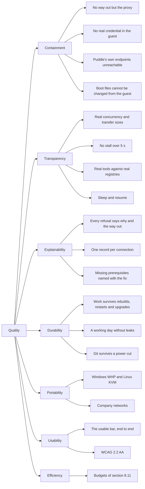

# 10. Quality requirements

The quality goals of section 1.3 broken down into a tree, and each leaf turned into a scenario
with a measurable bar and the test or CI job that checks it. Section 8.11 has the performance
budgets; this section does not repeat them. Where a bar is not met today, section 11 says so.

## 10.1 Quality tree

The five ranked goals of section 1.3, plus the two goals every release is judged by as a whole:
that a developer can do a day's work with it (usability), and that it stays inside its budgets
(efficiency).

## 10.2 Quality scenarios

Each scenario names a stimulus, the response Puddle must give and the measure that decides it.
"Every PR" means the check runs on pull requests that touch the area; "nightly" and "weekly" mean
scheduled runs on `develop` and runs by dispatch.

### Containment

| Scenario                                                                                                                         | Required response and measure                                                                                         | Checked by                                                                                    |
| -------------------------------------------------------------------------------------------------------------------------------- | --------------------------------------------------------------------------------------------------------------------- | --------------------------------------------------------------------------------------------- |
| A root process in the guest kills the agent and speaks to the vsock route with its own client                                   | It reaches only Puddle's proxy, which decides as for any request; nothing leaves by another path                       | `crates/puddle-host/tests/vm_hostile.rs` (Linux KVM and Windows WHP)                          |
| Root in the guest remounts Puddle's boot files writable and writes to them                                                      | No byte of the host's copy changes; the judge of the test fails when the share is made writable (negative control)    | `crates/puddle-compute-msb/tests/vm_hostile_boot.rs`, `mount_attack_control.rs`               |
| A guest connects to the API, the pull proxy or another of Puddle's endpoints, with every local-destination toggle on            | Refused; no toggle and no rule reaches Puddle's own endpoints                                                         | `crates/puddle-netpolicy/src/guard/tests.rs`                                                  |
| A tool signs in inside the workspace and the answer has a token Puddle cannot keep                                              | The login fails with a `502`; the real token never reaches the workspace                                              | `crates/puddle-logins` tests; `crates/puddle-host/tests/vm_logins.rs`                         |
| A workspace sends a captured login's stand-in to another host, or another workspace uses it                                     | The stand-in is not swapped there; it is worth nothing outside its workspace and host                                 | `crates/puddle-host/tests/vm_logins.rs`                                                       |
| A security-relevant change lands                                                                                                | It carries a hostile-guest test that treats everything from the guest as an attack                                    | [STANDARDS.md](../STANDARDS.md), "Testing"; review                                            |

### Transparency

The bar for every case: real high-concurrency workloads and synthetic tests up to the tools'
widest finish with **zero failures and no stall over 5 s** (a stall is a gap with no progress on
a stream); throughput is measured and reported next to a direct connection.

| Scenario                                                                                         | Required response and measure                                                              | Checked by                                                                                           |
| ------------------------------------------------------------------------------------------------ | ------------------------------------------------------------------------------------------ | ---------------------------------------------------------------------------------------------------- |
| 1 024 parallel connects through the proxy                                                        | All succeed, no stall                                                                      | `crates/puddle-e2e/tests/transparency.rs`, in the Rust tests of `.github/workflows/ci.yml`                          |
| 1 000 requests in a row on one kept-alive tunnel                                                 | All answered, the slowest reported                                                         | same file                                                                                            |
| 1 GiB up and 1 GiB down through the proxy                                                        | Every byte arrives, no stall; throughput reported against direct                           | same file                                                                                            |
| A connection closed in one direction; a client reading 1 KiB a second for a minute               | The other direction keeps working; the slow reader is not cut off                          | same file                                                                                            |
| A storm of 2 048 requests, each on its own tunnel; many HTTP/2 streams with a big download       | All succeed                                                                                | same file                                                                                            |
| The same shapes from inside a real guest with `curl`                                             | Same bar, through the agent and the vsock                                                  | `vm_host_transparency_bar_curl_at_its_widest_through_agent_and_proxy` in `crates/puddle-host/tests/vm_host.rs` |
| 256 parallel downloads in a guest                                                                | Every one completes with every byte, none goes 5 s without progress                        | `vm_perf_vsock_256_parallel_downloads_complete_without_a_stall` in `crates/puddle-host/tests/vm_perf_vsock.rs`, nightly |
| 1 000 requests on one kept-alive connection from a guest                                         | The cost per request on Windows stays within 3 times the Linux figure                      | `vm_perf_keepalive_request_costs_within_three_times_linux`, same file, nightly                       |
| A cold `npm` install in a guest                                                                  | Within 2.0 times the same install on the host                                              | measured by hand; no standing test (section 11)                                                      |
| apt, npm, pnpm, cargo, go and maven fetch cold from real registries, decrypted and spliced       | They finish; a failure becomes a new synthetic case                                        | "real-tool radar" in `.github/workflows/full-test.yml` (non-blocking, by dispatch)                   |
| The host sleeps for 5 minutes with a workspace busy                                              | The workspace and its connections carry on after resume                                    | `vm_soak_host_sleep_fake_5_min` in `crates/puddle-host/tests/vm_sleep.rs`                            |

### Explainability

| Scenario                                                       | Required response and measure                                                                                              | Checked by                                                                          |
| -------------------------------------------------------------- | -------------------------------------------------------------------------------------------------------------------------- | ----------------------------------------------------------------------------------- |
| A tool connects to a host no rule covers                       | An immediate `403` whose body names the pending request and how to allow it; a row in the Inbox                            | `crates/puddle-proxy/src/proxy/admit.rs` tests; the `usable` job                    |
| `ssh` to a host Puddle does not serve as a Git host            | An explicit refusal with the reason, not a bare "connection closed"                                                        | the `usable` job in `.github/workflows/msi.yml`                                     |
| Any connection, allowed or refused                             | One audit record with the decision, the rule or block reason, and the workspace                                            | `crates/puddle-store` audit tests; section 8.3                                      |
| A prerequisite is missing (hypervisor, runtime, disk, store)   | `puddle doctor` and the first-run check name it and give the exact fix                                                     | `crates/puddle-doctor` tests; `vm_doctor_through_the_api_boots_a_test_machine_and_needs_the_token` in `crates/puddle-host/tests/vm_first_run.rs` |

### Durability

| Scenario                                                                                                       | Required response and measure                                                                                               | Checked by                                                                                    |
| -------------------------------------------------------------------------------------------------------------- | --------------------------------------------------------------------------------------------------------------------------- | --------------------------------------------------------------------------------------------- |
| The installed app is upgraded from the last release with a workspace that has files                           | The workspace and its files are there after the upgrade                                                                     | job "upgrade (from the last release, a workspace with files)" in `.github/workflows/msi.yml` |
| Puddle quits with workspaces running                                                                           | Each VM is trimmed (up to 30 s) and stopped (up to 45 s); the volume and the root disk are kept                            | `crates/puddle-lifecycle/src/shutdown.rs`; section 6.7                                        |
| A VM is killed during `git commit` or a large `git add`                                                       | The index is intact at the next boot                                                                                        | the power-cut measurement behind the Git settings (section 9.4.3); `crates/puddle-boot/src/plan.rs` |
| The user deletes a workspace                                                                                   | Puddle first lists uncommitted changes, unpushed commits and stashes on its volume                                          | `crates/puddle-workspace` delete check                                                        |
| A working day: four busy workspaces, Inbox batches, a stop and start, a quit and start, a backup under load, a hard kill, then a night idle | No MAJOR finding: no leak, no growth against hour 0, API latency within its bar. On Windows, the editor window closes after each close, 10 of 10 | `.github/workflows/soak.yml` and `soak-windows.yml` (weekly and by dispatch; a canary run proves the judge sees a planted leak) |
| Ten browser editor opens and closes                                                                            | No extension host left behind, and the memory comes back                                                                    | `vm_soak_browser_code_server_ten_opens_and_closes_*` in `crates/puddle-host/tests/vm_browser_editor.rs` |

### Portability

| Scenario                                                                    | Required response and measure                                                     | Checked by                                                                                       |
| --------------------------------------------------------------------------- | --------------------------------------------------------------------------------- | ------------------------------------------------------------------------------------------------ |
| The same change on Linux KVM and on Windows WHP                             | The VM suites pass on both hosted runners                                         | `.github/workflows/vm-linux.yml`, `.github/workflows/vm-windows.yml`                             |
| Three workspaces created at once                                            | Three machines, all stopped together at quit                                      | `vm_three_workspaces_created_at_once_are_three_machines_and_stop_at_once` in `crates/puddle-host/tests/vm_first_run.rs` |
| The installed app behind a company network: PAC, NTLM sign-in, TLS inspection | The whole usable run passes                                                       | job "usable (behind the company network: PAC, NTLM sign-in, TLS inspection)" in `.github/workflows/msi.yml`; `.github/workflows/company-network-windows.yml` |
| Puddle on macOS                                                             | The doctor reports the system as unsupported, with the reason                     | `.github/workflows/macos.yml`; `crates/puddle-doctor/src/diagnose.rs`                            |

### Usability

The **usable bar** is the release bar a person would otherwise check by hand, run with no person
in CI: install, create, approve, edit, build, push.

| Scenario                                                                                     | Required response and measure                                                       | Checked by                                                                                    |
| -------------------------------------------------------------------------------------------- | ----------------------------------------------------------------------------------- | --------------------------------------------------------------------------------------------- |
| Install the unsigned per-user MSI on a clean Windows machine; upgrade it; uninstall it        | Each step succeeds without administrator rights; the upgrade keeps the data folder; the uninstall leaves nothing outside Puddle's own data folders | job "msi (build, install, upgrade, uninstall)" in `.github/workflows/msi.yml` (`ci/msi-install-test.ps1`) |
| Create a workspace from a Git remote, approve its first request in the Inbox, open the browser editor, run a real build, push over HTTPS with the injected credential | Each step succeeds in the installed app, driven through its window                 | job "usable (installed app: create, approve, editor, build, push)" in `.github/workflows/msi.yml` (`crates/puddle-app/e2e/usable.mjs`) |
| Attach desktop VS Code to a workspace                                                        | The checkouts show and the guest reaches the host as documented                     | `vm_vscode_attach_shows_the_checkouts_and_the_guest_reaches_this_computer_as_documented` in `crates/puddle-host/tests/vm_vscode.rs`, run by `.github/workflows/vm-windows.yml` |
| SSH to a Git host Puddle serves, and to one it does not                                      | The first works; the second fails with the explicit message                         | `crates/puddle-host/tests/vm_git_ssh.rs`; the `usable` job                                     |
| Every screen in both themes, by keyboard only                                                | Zero axe violations at WCAG 2.2 AA; every action reachable by keyboard               | `ui/e2e` (the `ui-e2e` gate)                                                                  |

### Efficiency

The ceilings on termination cost, memory per connection, kept-alive round trips, API latency at
volume, bundle size and the rules screen at 1 000 rules are in section 8.11, with the files that
check them. The release-build proxy throughput and memory run nightly in
`.github/workflows/perf.yml`.
